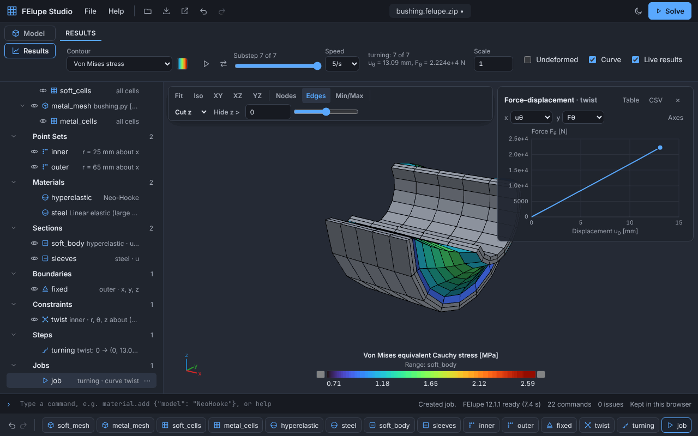
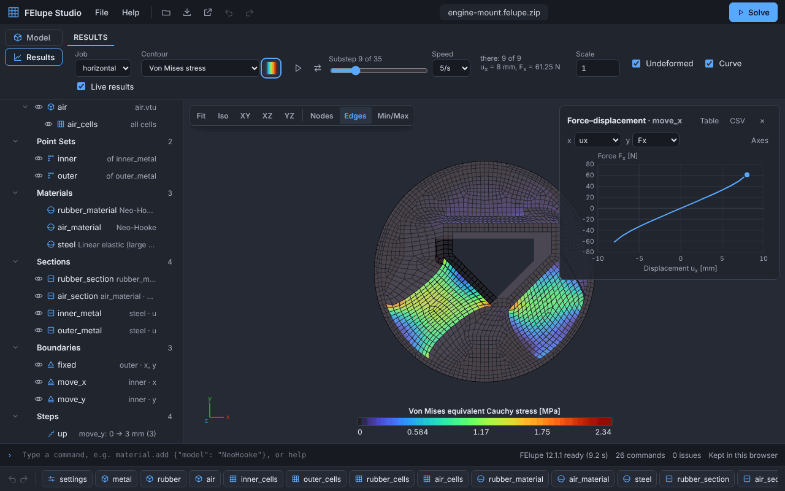

# felupe-studio

A graphical modeling environment for [FElupe](https://github.com/adtzlr/felupe): build, solve and evaluate finite element models of solids, entirely in the browser.

Every node in the GUI is a FElupe object. Every action is a command; the command list is saved as a text-diffable project file and turned into a readable FElupe script, which runs in the browser with [Pyodide](https://pyodide.org) and can be exported.

**Open the app:** <https://adtzlr.github.io/felupe-studio/>


FElupe Studio builds models of solids, hyperelastic (e.g. rubber) or elastic-plastic (e.g. steel), in 3D, in plane strain or axisymmetric, from mesh files, Python scripts or the mesh tools of FElupe (also of the meshes of files and scripts), with parameters (also derived ones): cell sets from cell tags, materials (linear elastic for small or large strains; hyperelastic like Neo-Hooke, Mooney-Rivlin, Yeoh, Ogden, Arruda-Boyce, …, also with the Mullins effect; strain-based, also elastic-plastic; user-defined in a Python file: a constitutive model, a strain energy function or a strain-based function), sections with the `u`, `u-isochoric` (e.g. air as a third medium) or a nearly incompressible formulation (condensed per cell, mixed fields or the three-field variation of any material with a volumetric part), point sets (by a plane, at a bound, on a cylinder, on the outer surface, of a section, by picked surfaces or nodes), face sets, boundaries, symmetry planes and load cases, control points, multi-point constraints with rotation points (e.g. a rigid plate glued to a face), Cartesian constraints in a rotated coordinate system (e.g. a support on an inclined plane), cylindrical constraints about an axis (e.g. a rigid sleeve or a torsion), rigid planes and cylinders with contacts and friction, point loads and pressures, and steps that ramp several items with their own values and switch boundaries on and off, in jobs that may repeat a step for a load cycle. Solve runs in the browser with live results; the results show the deformed shape with contours of the displacement, the strains and the stresses per substep (at the cells or smooth at the points), the equivalent plastic strain and the maximum strain energy density of the Mullins effect, their minimum and maximum, the range of the contour of all or of chosen sections (the others in one color or hidden), the force-displacement (or moment-rotation) curve with free axes and the displacements and forces of the control points, and play the substeps. A plane normal to x, y or z cuts the view, also of the results, so the inside of a model is seen. The FElupe script, the results (XDMF/VTU/CSV), the meshes and pictures of the view can be exported, and the XDMF results of a job imported again, whatever model is open; a project is saved as a text file or as an archive with its mesh files, with the save dialog of the system where the browser has one. The app has a dark and a light theme, and on a phone a compact layout.

Version 0.11 adds:
- **The formulation of a section, chosen in the Sections ribbon:** the displacements; nearly incompressible in one of three ways, condensed per cell, on mixed fields or the three-field variation of any material with a volumetric part of its own; or the isochoric part only, of a third medium.
- **Constraints in local coordinates:** points held or moved in a rotated Cartesian coordinate system, e.g. on an inclined plane, or radially, around and along an axis, e.g. in a rigid sleeve or a sleeve of a bushing turned about its axis.
- **User-defined materials from a Python file next to the project:** a constitutive model, a strain energy function of tensortrax or a strain-based function, each with a template to download from the dialog of the new material. The arguments of a function are fields of the material, and an error of the file is an issue with its traceback before a job.
- **Mesh tools for every mesh:** a mesh of a file or of a script is an input of the mesh tools, e.g. the half of a model from Gmsh, mirrored and stacked into the whole with the cell sets of its tags, or a 2D profile of a file revolved into a body.
- **Sections without volume:** a part of a mesh script that is empty for some values of the parameters is one degenerate cell, and its section is off in every step.
- **The results of an XDMF file** exported before, shown again whatever model is open.



Version 0.10 added a cut through the model, steps that switch boundaries on and off, more mesh tools (*Stack*, *Circle* and *Triangle*), the other sections of a range in one color or hidden and the save dialog of the system. Version 0.9 added pictures for reports with a light theme, own colors of sections and cell sets, the range of a contour from chosen sections and the app on a phone. Version 0.8 added your own deployment under the name of an institute or a company ([your own deployment](docs/deployment.md)), load cycles with the Mullins effect and derived parameters. Version 0.7 added the mesh tools of FElupe in the app, PARDISO with Python on your computer and a fixed link of `felupe-studio serve`. Version 0.6 added expressions of parameters, Python on your computer (`felupe-studio serve`), agents on the open app and single precision. Version 0.5 added plasticity, the strains and stresses at the points, the samples of the engine mount and the metacone, and the MCP server. Version 0.4 added parameters and mesh scripts, 2D models, symmetry planes and contacts with rigid surfaces. See the [changelog](CHANGELOG.md).




**Python on your computer:** `pip install "felupe-studio[serve]"`, then `felupe-studio serve` opens the same app with the Python of your computer instead of Pyodide: native NumPy and SciPy for large models, and mesh scripts with your own packages ([user guide](docs/guide.md#python-on-your-computer)).

**AI agents:** with `pip install "felupe-studio[serve,mcp]"`, `felupe-studio serve --agent` lets an agent like Claude Code or GitHub Copilot work on the model that is open in your browser. *Help ▸ Connect an agent* connects the tab; you see every change in the history and undo it, and you read a mesh script of the agent before it runs ([agents](docs/agents.md)). Headless, `felupe-studio-mcp` builds, checks and solves models with CPython, and you open the saved project in the app.


**Documentation:** the [user guide](docs/guide.md) with tutorials, the [command reference](docs/reference.md), how the [commands](docs/commands.md) become a FElupe script, the [MCP server](docs/agents.md) for AI agents, [your own deployment](docs/deployment.md) under your own name, the [architecture decision records](docs/adr/), the [changelog](CHANGELOG.md) and the [roadmap](https://github.com/adtzlr/felupe-studio/issues/416).

**Non-goals:** meshing from CAD, contact between deformable bodies (contacts are with rigid planes and cylinders), a server backend (the MCP server and `felupe-studio serve` run on your computer).

## Repository layout

| Path | Content |
| --- | --- |
| `app/` | The web app (TypeScript, Vite) |
| `python/felupe_studio/` | Python package: command list → FElupe script (runs in Pyodide and CPython), the MCP server for AI agents (`mcp.py`, CPython) and the local runtime of the app (`felupe-studio serve`: `serve.py`, `runtime.py`, CPython) |
| `tests/` | Python tests |
| `docs/adr/` | Architecture decision records |
| `docs/` | User guide, command reference (generated by `docs/make_reference.py`), screenshots (`docs/images`, made by `docs/make_screenshots.py`), commands, your own deployment, benchmarks and the [release checklist](docs/release.md) |

## Development

Web app:

```bash
cd app
npm install
npm run dev      # development server
npm test         # unit tests (Vitest)
npm run lint     # ESLint and Prettier
npm run build    # typecheck and production build
```

Python package:

```bash
pip install -e ".[test,mcp,serve]"
pytest            # the app in a browser: pytest -m e2e (Playwright, a built app)
ruff check . && ruff format --check .
```

## License

felupe-studio is licensed under GPL-3.0-or-later, the same license as [FElupe](https://github.com/adtzlr/felupe).
