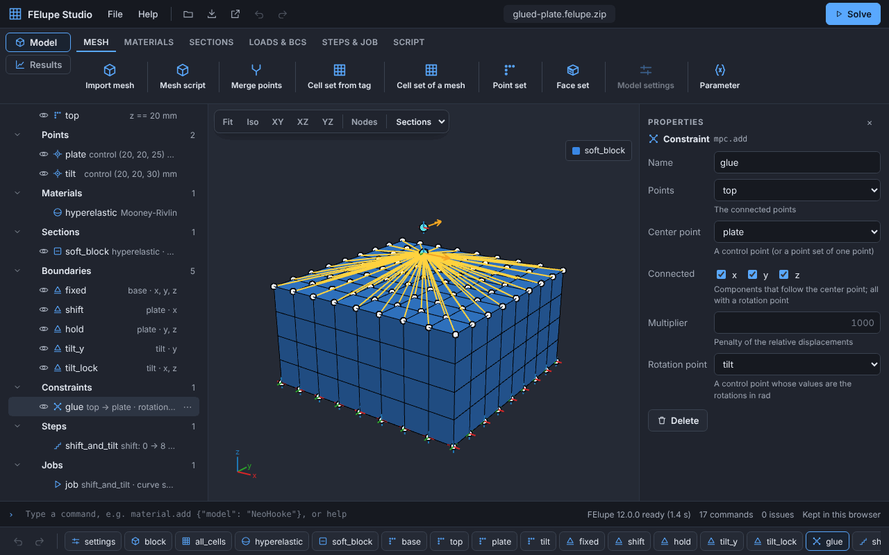
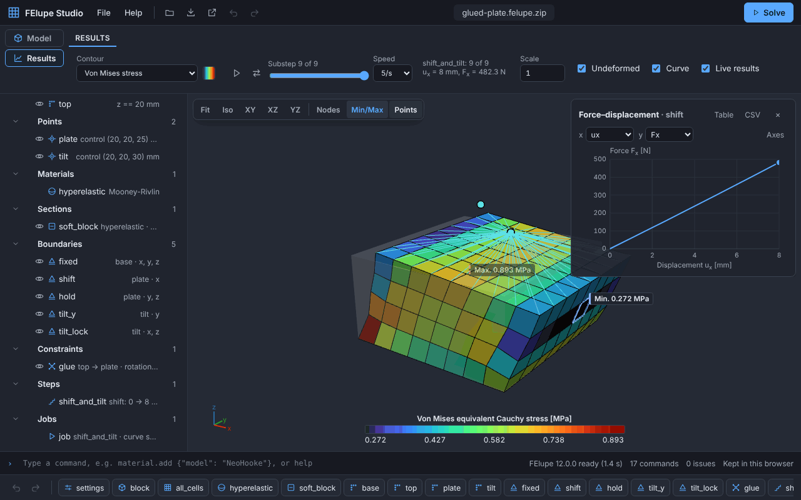

# felupe-studio

A clickable GUI for [FElupe](https://github.com/adtzlr/felupe) that runs entirely in the browser.

Every node in the GUI is a FElupe object. Every action is a command; the command list is saved as a text-diffable project file and turned into a readable FElupe script, which runs in the browser with [Pyodide](https://pyodide.org) and can be exported.

**Open the app:** <https://adtzlr.github.io/felupe-studio/>



FElupe Studio builds models of hyperelastic solids from mesh files: cell sets from cell tags, materials (Neo-Hooke, Mooney-Rivlin, Yeoh, Ogden, Arruda-Boyce, …), sections with the `u` or `u-p-J` formulation, point sets (by a plane, by picked nodes or by ids), face sets, boundaries and load cases, control points, multi-point constraints with rotation points (e.g. a rigid plate glued to a face), point loads and pressures, and steps that ramp several items with their own values. Solve runs in the browser with live progress; the results show the deformed shape with contours of the displacement, the strains and the stresses per substep, their minimum and maximum, the force-displacement (or moment-rotation) curve and the displacements and forces of the control points, and play the substeps. The FElupe script, the results (XDMF/VTU/CSV) and pictures of the view can be exported; a project is saved as a text file or as an archive with its mesh files.

Version 0.3 adds the units of a model, the material models of tensortrax, contour settings (color maps, bands, ranges), the minimum and maximum of a contour, playing the substeps, project archives (`.felupe.zip`), face sets and pressures. See the [changelog](CHANGELOG.md).



**Documentation:** the [user guide](docs/guide.md) with a tutorial, the [command reference](docs/reference.md), how the [commands](docs/commands.md) become a FElupe script, the [architecture decision records](docs/adr/), the [changelog](CHANGELOG.md) and the [roadmap](https://github.com/adtzlr/felupe-studio/issues/104).

**Non-goals:** meshing from CAD, contact, a server backend.

## Repository layout

| Path | Content |
| --- | --- |
| `app/` | The web app (TypeScript, Vite) |
| `python/felupe_studio/` | Python package: command list → FElupe script (runs in Pyodide and CPython) |
| `tests/` | Python tests |
| `docs/adr/` | Architecture decision records |
| `docs/` | User guide, command reference (generated by `docs/make_reference.py`), screenshots (`docs/images`, made by `docs/make_screenshots.py`), commands, benchmarks and the [release checklist](docs/release.md) |

## Development

Web app:

```bash
cd app
npm install
npm run dev      # development server
npm test         # unit tests (Vitest)
npm run lint     # ESLint and Prettier
npm run build    # typecheck and production build
```

Python package:

```bash
pip install -e ".[test]"
pytest
ruff check . && ruff format --check .
```

## License

felupe-studio is licensed under GPL-3.0-or-later, the same license as [FElupe](https://github.com/adtzlr/felupe).
