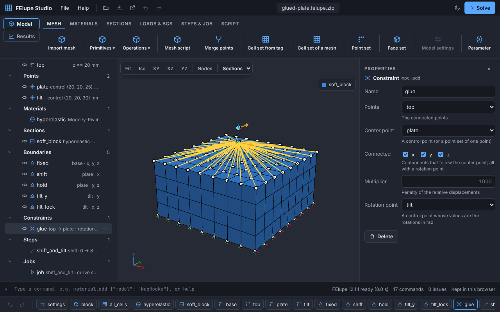
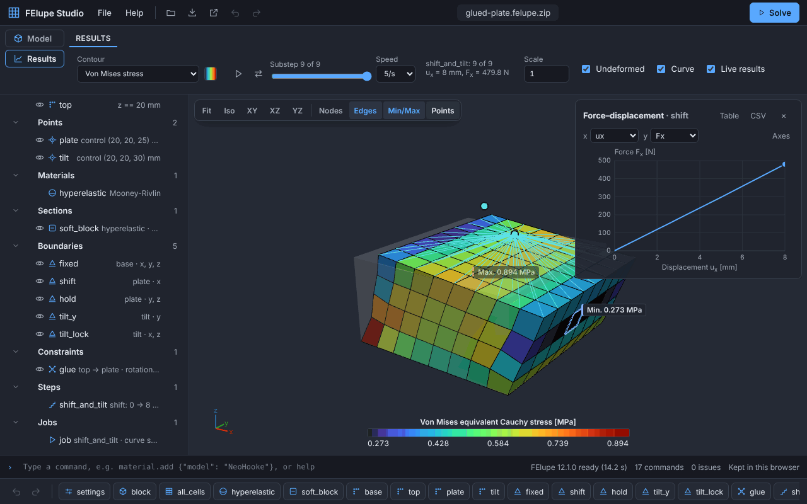

# felupe-studio

A clickable GUI for [FElupe](https://github.com/adtzlr/felupe) that runs entirely in the browser.

Every node in the GUI is a FElupe object. Every action is a command; the command list is saved as a text-diffable project file and turned into a readable FElupe script, which runs in the browser with [Pyodide](https://pyodide.org) and can be exported.

**Open the app:** <https://adtzlr.github.io/felupe-studio/>



FElupe Studio builds models of solids, hyperelastic (e.g. rubber) or elastic-plastic (e.g. steel), in 3D, in plane strain or axisymmetric, from mesh files or from Python scripts with parameters: cell sets from cell tags, materials (linear elastic for small or large strains; hyperelastic like Neo-Hooke, Mooney-Rivlin, Yeoh, Ogden, Arruda-Boyce, …; strain-based, also elastic-plastic), sections with the `u`, `u-p-J` or `u-isochoric` formulation (e.g. air as a third medium), point sets (by a plane, at a bound, on a cylinder, on the outer surface, of a section, by picked surfaces or nodes), face sets, boundaries, symmetry planes and load cases, control points, multi-point constraints with rotation points (e.g. a rigid plate glued to a face), rigid planes and cylinders with contacts and friction, point loads and pressures, and steps that ramp several items with their own values. Solve runs in the browser with live results; the results show the deformed shape with contours of the displacement, the strains and the stresses per substep (at the cells or smooth at the points) and the equivalent plastic strain, their minimum and maximum, the force-displacement (or moment-rotation) curve with free axes and the displacements and forces of the control points, and play the substeps. The FElupe script, the results (XDMF/VTU/CSV), the meshes and pictures of the view can be exported; a project is saved as a text file or as an archive with its mesh files.

Version 0.5 adds plasticity with the strain-based materials of FElupe 12.1 (linear elastic and elastic-plastic with isotropic hardening, in small strain or with large deformations), the strains and the stresses at the points of the meshes (projected or shifted, also in the exports), the samples of the engine mount (ex07, with air as a third medium) and the metacone (ex15), an MCP server for AI agents, the material models in menus by their kind (linear elasticity, hyperelasticity, strain-based elasticity), picking by clicks and taps without a right click (for touch screens), the export of a mesh, boundaries with a value per component and extra samples at build time. Version 0.4 added parameters and mesh scripts, 2D models, symmetry planes and contacts with rigid surfaces. See the [changelog](CHANGELOG.md).




**AI agents:** an [MCP server](docs/agents.md) lets agents like Claude Code or GitHub Copilot build, check and solve models, headless with CPython on your computer (`pip install "felupe-studio[mcp]"`, then `felupe-studio-mcp`); you open the saved project in the app.

**Documentation:** the [user guide](docs/guide.md) with a tutorial, the [command reference](docs/reference.md), how the [commands](docs/commands.md) become a FElupe script, the [MCP server](docs/agents.md) for AI agents, the [architecture decision records](docs/adr/), the [changelog](CHANGELOG.md) and the [roadmap](https://github.com/adtzlr/felupe-studio/issues/272).

**Non-goals:** meshing from CAD, contact between deformable bodies (contacts are with rigid planes and cylinders), a server backend (the MCP server runs on your computer).

## Repository layout

| Path | Content |
| --- | --- |
| `app/` | The web app (TypeScript, Vite) |
| `python/felupe_studio/` | Python package: command list → FElupe script (runs in Pyodide and CPython), and the MCP server for AI agents (`mcp.py`, CPython) |
| `tests/` | Python tests |
| `docs/adr/` | Architecture decision records |
| `docs/` | User guide, command reference (generated by `docs/make_reference.py`), screenshots (`docs/images`, made by `docs/make_screenshots.py`), commands, benchmarks and the [release checklist](docs/release.md) |

## Development

Web app:

```bash
cd app
npm install
npm run dev      # development server
npm test         # unit tests (Vitest)
npm run lint     # ESLint and Prettier
npm run build    # typecheck and production build
```

Python package:

```bash
pip install -e ".[test,mcp]"
pytest
ruff check . && ruff format --check .
```

## License

felupe-studio is licensed under GPL-3.0-or-later, the same license as [FElupe](https://github.com/adtzlr/felupe).
