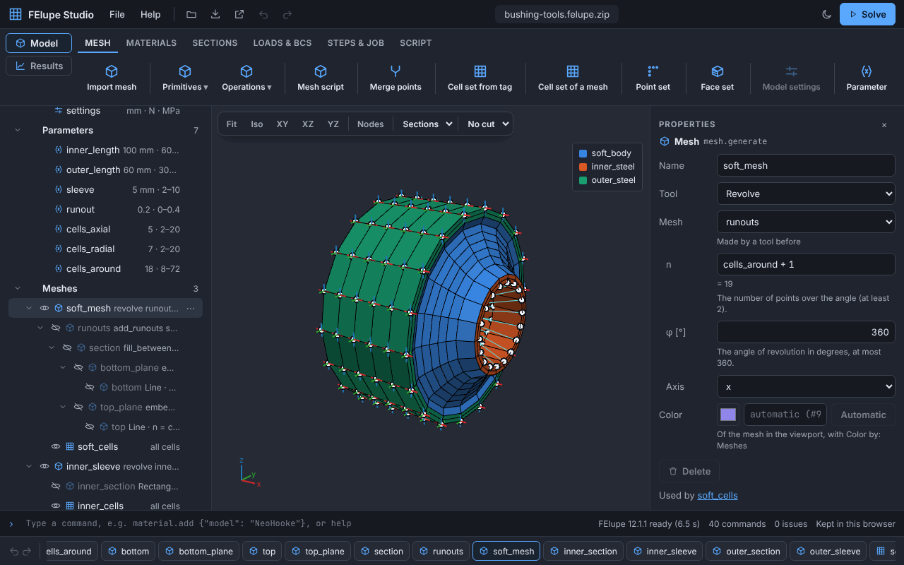
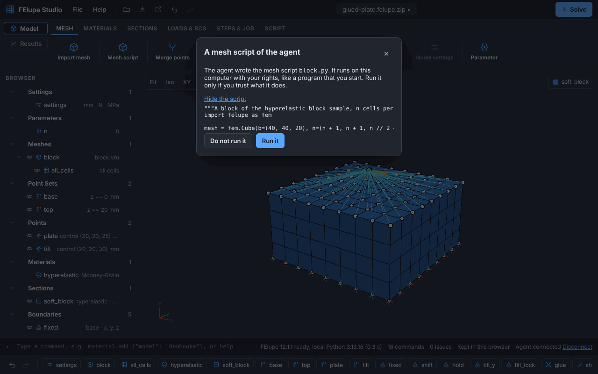

# felupe-studio

A clickable GUI for [FElupe](https://github.com/adtzlr/felupe) that runs entirely in the browser.

Every node in the GUI is a FElupe object. Every action is a command; the command list is saved as a text-diffable project file and turned into a readable FElupe script, which runs in the browser with [Pyodide](https://pyodide.org) and can be exported.

**Open the app:** <https://adtzlr.github.io/felupe-studio/>


FElupe Studio builds models of solids, hyperelastic (e.g. rubber) or elastic-plastic (e.g. steel), in 3D, in plane strain or axisymmetric, from mesh files, Python scripts or the mesh tools of FElupe, with parameters: cell sets from cell tags, materials (linear elastic for small or large strains; hyperelastic like Neo-Hooke, Mooney-Rivlin, Yeoh, Ogden, Arruda-Boyce, …; strain-based, also elastic-plastic), sections with the `u`, `u-p-J` or `u-isochoric` formulation (e.g. air as a third medium), point sets (by a plane, at a bound, on a cylinder, on the outer surface, of a section, by picked surfaces or nodes), face sets, boundaries, symmetry planes and load cases, control points, multi-point constraints with rotation points (e.g. a rigid plate glued to a face), rigid planes and cylinders with contacts and friction, point loads and pressures, and steps that ramp several items with their own values. Solve runs in the browser with live results; the results show the deformed shape with contours of the displacement, the strains and the stresses per substep (at the cells or smooth at the points) and the equivalent plastic strain, their minimum and maximum, the force-displacement (or moment-rotation) curve with free axes and the displacements and forces of the control points, and play the substeps. The FElupe script, the results (XDMF/VTU/CSV), the meshes and pictures of the view can be exported; a project is saved as a text file or as an archive with its mesh files.

Version 0.7 adds:
- **The mesh tools of FElupe in the app:** points, lines, rectangles and cubes, and the operations expand, revolve, embed, translate, rotate, mirror, fill between and add runouts make meshes without a file or a script, with expressions of the parameters. The meshes a mesh is made of are construction meshes, below it in the browser. The sample *Bushing made with mesh tools* makes the bushing of FElupe's ex05 this way.
- **PARDISO** (Intel oneMKL) as the linear solver of a job with Python on your computer: `pip install "felupe-studio[serve,pardiso]"`, e.g. 7 times faster than SuperLU for a 3D model with 28,000 degrees of freedom on 2 cores.
- **A fixed link** of `felupe-studio serve` with the environment variable `FELUPE_STUDIO_TOKEN`, e.g. for the `.mcp.json` of an agent.

Version 0.6 added expressions of parameters, Python on your computer (`felupe-studio serve`), agents on the open app and single precision. Version 0.5 added plasticity, the strains and stresses at the points, the samples of the engine mount and the metacone, and the MCP server. Version 0.4 added parameters and mesh scripts, 2D models, symmetry planes and contacts with rigid surfaces. See the [changelog](CHANGELOG.md).




**Python on your computer:** `pip install "felupe-studio[serve]"`, then `felupe-studio serve` opens the same app with the Python of your computer instead of Pyodide: native NumPy and SciPy for large models, and mesh scripts with your own packages ([user guide](docs/guide.md#python-on-your-computer)).

**AI agents:** with `pip install "felupe-studio[serve,mcp]"`, `felupe-studio serve --agent` lets an agent like Claude Code or GitHub Copilot work on the model that is open in your browser. *Help ▸ Connect an agent* connects the tab; you see every change in the history and undo it, and you read a mesh script of the agent before it runs ([agents](docs/agents.md)). Headless, `felupe-studio-mcp` builds, checks and solves models with CPython, and you open the saved project in the app.



**Documentation:** the [user guide](docs/guide.md) with a tutorial, the [command reference](docs/reference.md), how the [commands](docs/commands.md) become a FElupe script, the [MCP server](docs/agents.md) for AI agents, the [architecture decision records](docs/adr/), the [changelog](CHANGELOG.md) and the [roadmap](https://github.com/adtzlr/felupe-studio/issues/317).

**Non-goals:** meshing from CAD, contact between deformable bodies (contacts are with rigid planes and cylinders), a server backend (the MCP server and `felupe-studio serve` run on your computer).

## Repository layout

| Path | Content |
| --- | --- |
| `app/` | The web app (TypeScript, Vite) |
| `python/felupe_studio/` | Python package: command list → FElupe script (runs in Pyodide and CPython), the MCP server for AI agents (`mcp.py`, CPython) and the local runtime of the app (`felupe-studio serve`: `serve.py`, `runtime.py`, CPython) |
| `tests/` | Python tests |
| `docs/adr/` | Architecture decision records |
| `docs/` | User guide, command reference (generated by `docs/make_reference.py`), screenshots (`docs/images`, made by `docs/make_screenshots.py`), commands, benchmarks and the [release checklist](docs/release.md) |

## Development

Web app:

```bash
cd app
npm install
npm run dev      # development server
npm test         # unit tests (Vitest)
npm run lint     # ESLint and Prettier
npm run build    # typecheck and production build
```

Python package:

```bash
pip install -e ".[test,mcp,serve]"
pytest            # the app in a browser: pytest -m e2e (Playwright, a built app)
ruff check . && ruff format --check .
```

## License

felupe-studio is licensed under GPL-3.0-or-later, the same license as [FElupe](https://github.com/adtzlr/felupe).
