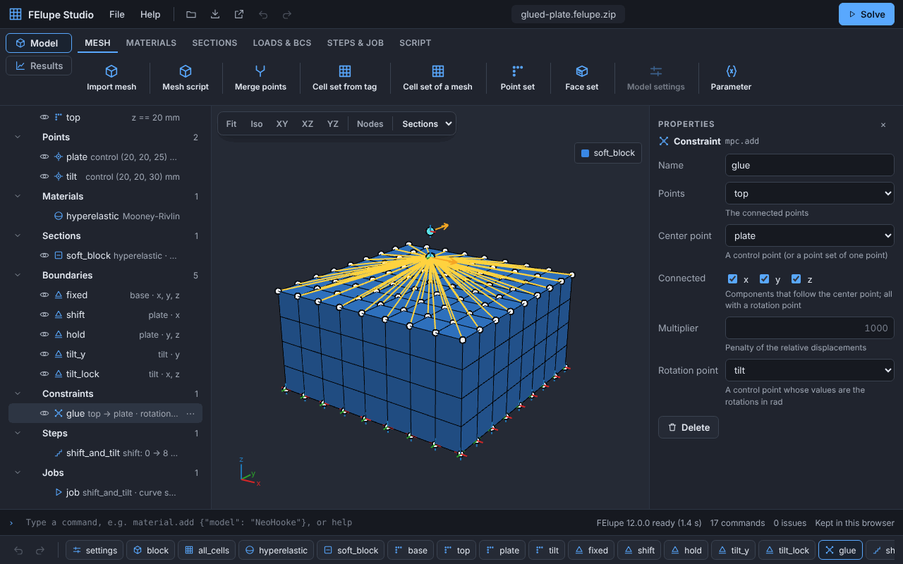
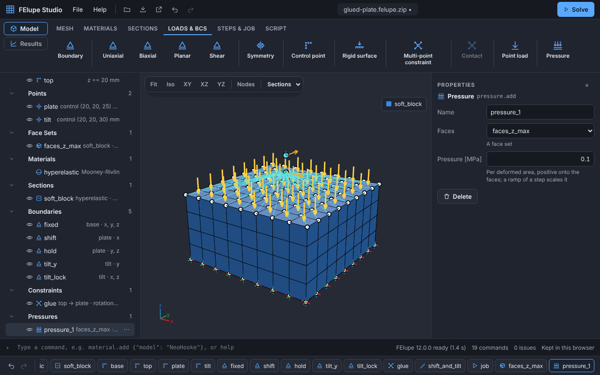
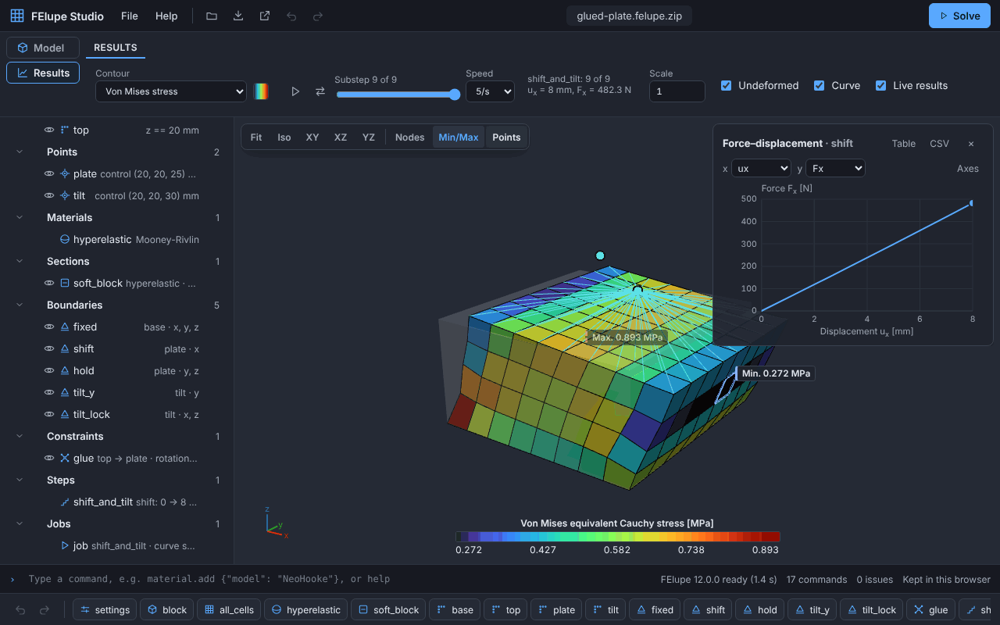

# User guide

FElupe Studio builds models of hyperelastic solids from mesh files, solves them with [FElupe](https://github.com/adtzlr/felupe) in the browser and shows the results. Nothing is installed and nothing is uploaded: Python runs in the browser with [Pyodide](https://pyodide.org).

**Open the app:** <https://adtzlr.github.io/felupe-studio/>

The first start downloads Python, NumPy, SciPy and FElupe; the browser keeps them for the next visits. The [command reference](reference.md) lists every property of every command, [commands.md](commands.md) explains how the commands become a FElupe script.

## The idea

Every object of a model is a FElupe object, and every action creates or changes a **command**: `mesh.import`, `material.add`, `boundary.add`, … The project file (`*.felupe.json`) is the list of these commands, a small text file that is easy to compare and to keep in version control. The commands are turned into a readable FElupe script, which is what runs when you solve and what you can export.

## The window



- **Header:** the menus **File** (new, open, samples, save and the exports) and **Help** (this guide, the command reference, the keyboard shortcuts and *About* with the versions of FElupe, Python and Pyodide), buttons for Open, Save, Export, Undo and Redo, and **Solve**.
- **Ribbon:** the workspaces **Model** and **Results**. The tabs of the model create its objects in the order in which a model is usually built: Mesh, Materials, Sections, Loads & BCs, Steps & Job. A button that cannot be used yet tells you what is missing, e.g. "Create a cell set and a material first."
- **Model browser** (left): the objects of the model in groups. A number at an object counts its issues. A click on an object selects it in the viewport and opens its **properties**, where you edit and **Apply** or **Delete** it. After a change, **Apply** (Enter) takes it over and **Reset** (Esc) discards it; an issue of the object is shown at its field, e.g. a missing material at *Material*. The tooltip of a symbol, e.g. C₁₀, names its key in the project file (`C10`). A right click on an object, its **⋯** button or Shift+F10 opens its menu: **Duplicate** (Ctrl+D) creates a copy with the next free name, e.g. `rubber_2`, right after the original and selects it, so a second material or boundary that differs in one value is quick to make; objects that use the original keep using it. **Rename** (F2), **Show/Hide** (H) and **Delete** (Del) work on the selected object too.
- **Viewport:** the meshes with their point sets, face sets, boundaries, control points, constraints, point loads and pressures. The toolbar has the views, *Fit*, *Color by* (mesh, cell set or section) and *Nodes*.
- **Footer:** the command line, the state of Python, the number of commands and issues, and the history: the commands in their order, with Undo (Ctrl+Z) and Redo (Ctrl+Shift+Z).

In narrow windows (up to 1000 px, e.g. a tablet or a small laptop window), the browser and the properties are drawers over the viewport: the button left of the logo opens the browser, a selection opens the properties, Esc closes them. The ribbon is one row that scrolls.

The project is kept in the browser with its mesh files: a reload restores it. To keep it elsewhere, save it.

### Save and open

A project is saved in one of two formats; the header shows its name with the suffix:

- a **project file** (`.felupe.json`): the commands as text, e.g. for version control. Keep it next to its mesh files and open them together.
- a **project archive** (`.felupe.zip`): one ZIP file with the project and its mesh files, to open it anywhere in one step. Any tool unpacks it; with the Python script inside, the unpacked folder runs with `python <name>.py`.

**Save project** (Ctrl+S) saves in the format of the project without asking. A project opened from an archive or a sample is an archive, one opened from a project file stays a project file, and a new project becomes an archive with its first mesh file. **Save project as…** (Ctrl+Shift+S) chooses the name and the format, for an archive also *Include the Python script*, and lists the mesh files with their sizes (a mesh file that is not loaded is missing in the archive).

**Open project** (or a drop on the window) opens a project file with its mesh files, an archive, also a folder of a project that you zipped yourself, or mesh files to import; files of an archive that the project does not use are listed and not opened. Opening a project replaces the mesh files of the previous one; with unsaved changes, the app asks first.

## Samples

An empty model shows a welcome panel with *Import mesh*, *Open project* and the samples; **File ▸ Samples…** lists them too. A sample opens as a ready-made model with its mesh files. They show the features step by step:

| Sample | Shows |
| --- | --- |
| Bar of two materials | cell sets from a cell tag of a VTU file, the `u` and `u-p-J` formulations, a force-displacement curve |
| Material test: uniaxial tension | a load case with symmetry planes, compared with the analytical curve |
| Hexahedrons and tetrahedrons | a Gmsh file with two types of cells |
| Rubber mount in shear | three sections, the Mooney-Rivlin model, the shear load case |
| Rubber block with a rigid plate | control points, a multi-point constraint with a rotation point, a step with several ramps |
| Sandwich spring with parameters | parameters, a mesh made by a Python script, point sets at the bounds of the meshes |
| Rubber-metal bushing (FElupe ex05) | a mesh script with the fineness of the mesh as parameters, point sets on cylinders, a rotation point for torsion and tilt |

Open a sample, press **Solve** and look at the results; then change a value in the properties and solve again.

The **sandwich spring** is a parametric sample: rubber discs between steel sheets, the base sheet fixed and the top sheet sheared by 12 mm. Its mesh comes from the script `sandwich_spring.py`, which gets the parameters *radius*, *layers*, *height*, *sheet* and *cells* and makes a dict of a rubber and a metal mesh on the same points. Opening it asks for the values first: with 5 layers instead of 3 the spring is softer by about 3/5, and the point sets `base` (`z == min`) and `top` (`z == max`) follow the height of the stack without a change.

The **rubber-metal bushing** is the example ex05 of FElupe: a rubber body between two steel sleeves, made by `bushing.py` with the lengths of the sleeves, their thickness, the runout of the free faces and the fineness of the mesh (cells along the axis, through the rubber and around it) as parameters. The outside of the outer sleeve (`r = 65`) is fixed; the inside of the inner sleeve (`r = 25`) is connected to a control point at the axis with a rotation point, which moves it by 8 mm in z, twists it by 30° about x and tilts it by −5° about y. The curve is the moment of the torsion over its angle. The multiplier of the connection (100000) is large compared with the steel, so the moment of the torsion agrees with ex05, which prescribes the rotated positions, within 0.1 %; a finer mesh is a change of three parameters.

## Building a model

### Units

FElupe has no units: the numbers of a model only need to fit together, e.g. millimetres, newtons and megapascals. **Model settings** (last button of the *Mesh* tab, at most one per model) say which units the numbers mean: the length (mm or m) and the force (N or kN); the unit of stresses and moduli follows (MPa, GPa, Pa or kPa). The forms, the browser and the results then show the units, e.g. *E [MPa]* or *u = (8, 0, 0) mm*, and the script gets them as a comment. Nothing is converted: if you change the units, the numbers stay the same and only their meaning changes. Rotations are always in rad.

### Parameters

A **Parameter** (*Mesh* tab, next to *Model settings*) is a named number of the model, e.g. the radius of a disc or the number of rubber layers. Its *Quantity* (length, force or stress) gives it the unit of the model settings; *Minimum*, *Maximum* and *Step* describe the values it may take, *Integer* makes it a whole number, and the *Description* says in a few words what it is. The browser lists the parameters below the settings, with their value and range; a value outside of the range is an issue of the parameter. The script defines the parameters as variables at its top, e.g. `radius = 50.0  # mm`, so you can change them there. A *Mesh script* gets them as variables (see Mesh). Opening a project with parameters shows their values first: change them (with a slider if they have a range) and *Open*, or *Keep the saved values*; the meshes of scripts are made after that. The dialog lists the scripts the project runs, with *Show* to read them first. Later, *All parameters…* in the menu of a parameter in the browser opens the same dialog; the changed values are one undo step.

### 1. Mesh

**Import mesh** reads any mesh file that meshio reads, e.g. VTK (`.vtu`, `.vtk`), Gmsh (`.msh`), Abaqus (`.inp`), XDMF, Medit or Exodus; **Open project** accepts mesh files too. The solid cells are tetrahedrons or hexahedrons, linear or quadratic. A file with several types of cells gives one mesh per type. The dialog shows the size of the mesh; its *Scale* multiplies the coordinates, e.g. by 1000 for a mesh made in metres of a model in millimetres. The dialog suggests it if the mesh is very small or very large for the units of the model (smaller than 1 mm or larger than 10 m). Point sets and points use the scaled coordinates, so set the scale before you add them.

**Mesh script** makes a mesh with a Python script next to the project, e.g. with the mesh tools of FElupe. Open the script like a mesh file (**Open project**, or drop it); a script opened alone starts a new mesh script with it. The script gets the **parameters** of the model as variables (all of them, or the chosen ones) and makes a variable `mesh`: a `fem.Mesh`, a `fem.MeshContainer`, a `meshio.Mesh` or a dict of names and meshes, of which *Item* takes one, e.g. `rubber`. For a rubber and a metal part, make a dict and add two mesh scripts with the items. A changed parameter makes the mesh again; an error of the script is an issue of the mesh, and its properties show the traceback. The script is kept with the project like a mesh file, also in archives, and the generated script runs it with `run_mesh_script()`, so it needs the script in its folder.

```python
import felupe as fem

# the parameters of the model, or these values if the script runs alone
radius = globals().get("radius", 50)
layers = globals().get("layers", 3)
height = globals().get("height", 8)

disc = fem.Circle(radius=radius, n=6)
mesh = {"rubber": disc.expand(n=layers + 1, z=height)}
```

The lines with `globals().get()` are optional: they give the script values of its own, so it also runs alone (`python disc.py`) and linters know the names.

The cells of a model come from **cell sets**: **Cell set of a mesh** takes all cells, **Cell set from tag** the cells with a value of an integer cell data array (the *Cell tag* of the import, e.g. `material` or `gmsh:physical`). The meshes are merged at their common points; **Merge points** also merges points that agree to a number of decimals, e.g. of meshes from different programs.

### 2. Materials and sections

The **Materials** tab has the material models, grouped in menus: *Neo-Hooke* (incompressible, or compressible with λ), *Polynomial* (Mooney-Rivlin, Yeoh, third-order deformation), *Ogden* (one to three terms: the moduli μᵢ and the exponents αᵢ as lists, e.g. `1, 0.2` and `1.7, -1.5`), *Micromechanical* (Arruda-Boyce, extended tube) and *Linear elastic (large strain)*. The rubber models have an optional bulk modulus K: without it they are incompressible and need the `u-p-J` formulation of a section; the defaults are the examples of the FElupe documentation. A **Section** assigns a material and a formulation to a cell set: `u` with the displacements only, or `u-p-J` for (nearly) incompressible materials with a bulk modulus K. The *Volumetric part* of `u-p-J` is the strain energy U(J) of the volume ratio J: *Volume ratio* K/2 (J − 1)² (the default), *Stretch* 9K/2 (J^⅓ − 1)² or *Logarithm* K/2 ln(J)². With a large bulk modulus (nearly incompressible) J stays close to 1 and the choice hardly matters; with a small one, e.g. of a foam-like or a compressible rubber, it changes the response. Every section becomes a solid body.

### 3. Point sets

A **point set** selects points of the merged meshes:

- **by a picked surface:** click a face of the model. The viewport picks its *connected surface*: the faces of its section that are reached over shared edges, as long as the normals of two neighbouring faces differ by at most the *Angle* of the panel (30° by default; 60° for a coarse cylinder, 180° for the whole boundary; kept in the browser). *Create point set* stores the simplest selection of the surface: a plane normal to x, y or z, e.g. `z == 0` (at the smallest or largest coordinate of the meshes as that bound, e.g. `z == max`, so that it stays the top of the model when the mesh changes), a cylinder about an axis parallel to x, y or z, e.g. the inner sleeve of a bushing, or else its nodes. A plane or cylinder that would select more nodes than the surface has (a part of a plane) stores the nodes. A face of a mesh without a section picks its plane, if it is normal to x, y or z.
- **at a bound:** the points at the smallest or largest coordinate of the meshes of the sections along an axis (*At a bound*), e.g. the top plate of a spring whose height changes. Control points do not count.
- **on a cylinder:** the points at a distance (*Radius*) from an axis parallel to x, y or z through a *Center* (default the origin), e.g. the inner sleeve of a bushing.
- **by nodes:** turn on *Nodes* in the toolbar, click a node and Shift+click more nodes, then *Create point set*. The point set stores the coordinates of the nodes, not their numbers; *Copy* copies the coordinates.
- **by ids:** the ids of the points of the merged meshes, e.g. from a script.

A selected point set is highlighted in the viewport; if a plane, a bound or a cylinder selects no node of the meshes, the viewport says so (e.g. a wrong radius).

A **face set** (Mesh tab) selects faces of the boundary of a section, e.g. for a pressure: click a face and *Create face set* takes its connected surface, stored as the plane if it is all faces of the section on a plane normal to x, y or z, else by the centers of its faces; Shift+click adds or removes single faces. The face sets are drawn as light faces, the selected one highlighted. FElupe has no faces of tetrahedrons yet: a face set needs a section of hexahedrons.

### 4. Boundaries and load cases

A **Boundary** prescribes displacement components of a point set: *Constrained* are the components, *Value* is the displacement (default 0). Components that are not constrained are free. To fix some components and move others, use two boundaries, e.g. `hold` with y and z and `move` with x.

A **Load case** creates the boundaries of a standard test at once (uniaxial, biaxial, planar, shear), optionally with symmetry planes. A step ramps the displacement of its moving end faces.

### 5. Control points, multi-point constraints and point loads

A **control point** is a point that is not a node of the meshes, e.g. the center of a rigid plate. *Control point at center* in the panel of a picked face, of picked nodes or of a selected point set creates one at the center of these points; then change its coordinates in the properties. A control point at the coordinates of a node is the node itself: the viewport warns about it.

A **Multi-point constraint** connects the points of a point set rigidly to a center point (a control point or a point set of one point). *Connected* are the components that follow the center point. With a **rotation point**, the points also rotate about the center point: the values of the rotation point are the rotations about x, y and z in rad, so a boundary of its y component with the value 0.1 tilts the points by 0.1 rad about the y axis. The viewport draws lines from the center point to the connected points.

A **control point needs a stiffness**: every component of it needs a boundary or a multi-point constraint. Otherwise the model has an issue, because the system of equations would be singular.

A **Point load** is a force at every point of a point set or at a control point. A ramp of a step scales the force from its start to its end value, so `end: 1` applies the full force.

A **Pressure** (Loads & BCs) acts on the faces of a face set, normal to the faces and per deformed area: a positive pressure pushes onto the faces, a negative one pulls. Like a point load, it is applied in full unless a step ramps it, and a ramp is a factor of the pressure. The viewport draws arrows onto (or away from) the faces.



### 6. Steps and jobs

A **Step** solves the model in increments. Its items are the sections, multi-point constraints, point loads and pressures (all of them, unless you choose some). *Ramped* lists the boundaries, load cases, point loads and pressures whose values change in the step, each with its own start and end value; *Increments* is the number of substeps of the step. All other boundaries keep their values.

A **Job** evaluates its steps one after another. With a *Curve* (a boundary, a load case or a point load) it records the force-displacement curve. *Tolerance* is the tolerance of the Newton-Raphson method: a substep has converged when the norm of the residual forces is smaller than this fraction of the norm of the reaction forces (FElupe adds 0.001 to the reaction forces, so for forces much smaller than 0.001 in the units of the model the criterion is absolute). It is 0.01 by default, like the force criterion of commercial codes: the forces deviate by much less than the accuracy of a hyperelastic model, at about half the time of FElupe's default (1.49e-8). Choose a tighter one, e.g. 1e-6, for curves that are fitted to test data or compared with a reference; as the Newton-Raphson method converges quadratically, this costs about one more iteration per substep. *Max. iterations* is the number of Newton iterations a substep may take (16 by default). *Cutback* retries a substep that does not converge with smaller increments: the increment is reduced by the *Factor* (0.5) up to *Max. cutbacks* times in a row (10) and grows again by *Growth* (2) after every converged increment. Leave these fields empty for the defaults (those of FElupe, except the tolerance); a smaller factor helps a substep that fails even after a few cutbacks.

### 7. Solve

**Solve** runs the jobs. It is available when the model has a job, no issues and its mesh files; otherwise its tooltip tells you what is missing. The job panel shows the substep and the Newton iterations; *Cancel* stops the job. If a job fails, the panel shows the message and the Python traceback.

## Results

The **Results** workspace shows the deformed shape of a substep:



- *Contour*: the displacement, the logarithmic strains or the Cauchy stresses (principal values and von Mises). The button beside it sets the **color map** (Turbo, Viridis, Cool–warm for signed values, centered at zero, or Grayscale for printing), **bands** (continuous or 6–20 discrete bands) and the **range**: of the substep, over all substeps of the job (to compare substeps), or manual, where values outside are drawn in an extra color. The settings are kept in the browser and used by the picture export.
- *Substep* and *Scale* of the displacements; *Undeformed* shows the shape before the deformation.
- ▷ (or Space) **plays** the substeps in a loop at the chosen *Speed* (substeps per second); the curve and the control points follow. Choose the range over all substeps in the contour settings to compare the colors while playing. Substeps that were shown once are shown at once again.
- *Curve*: the force-displacement curve with the current substep; download it as CSV.
- A hover over the model shows the value at the point under the pointer; *Nodes* shows the nodes of the deformed meshes.
- *Min/Max* marks the minimum and the maximum of the contour with their values: a dot at a node (values at the points) or the outline of the outer faces of a cell (values of the cells). A click on a label or a marker shows where the value is (the node or the cell and its section, *inside* if it is not at the surface); a click elsewhere or Esc hides it again. A label whose point is hidden behind the model is dimmed.
- The control points show their displacements and forces in the substep (rotations and moments for rotation points); the export has them for all substeps.
- A click on a **job** in the browser shows its results; a click on another object switches to the Model workspace with its properties. *Results* shows the results again as you left them; the eye of the browser hides a section in the results too.

## The script

The ribbon tab **Script** shows the FElupe script of the model instead of the viewport, exactly as it is exported, and updates it after every change. Selecting an object highlights its lines (e.g. a section: its region, field and solid body); a click on a line selects its object, so you can change a value in the properties and see the code change. *Copy* and *Download* take the whole script.

## Exports

The **Export** menu has

- the **Python script** of the model: it runs with FElupe and meshio outside the app, next to the mesh files,
- the **results of the job** (XDMF) and of the **substep** (VTU), e.g. for ParaView,
- the **control points** (CSV): displacements and forces per substep,
- a **picture of the view** (PNG).

## Keyboard shortcuts

**Help ▸ Keyboard shortcuts** (or `?`) lists them all; the menus and tooltips show them too. The most used:

| Keys | Action |
| --- | --- |
| Ctrl+S, Ctrl+O, Ctrl+Enter | Save, open, solve (⌘ on macOS) |
| Ctrl+Shift+S | Save as a project file or an archive |
| Ctrl+Z, Ctrl+Shift+Z | Undo, redo |
| Delete, F2, Esc | Delete or rename the selected object, clear the selection |
| Ctrl+D, H | Duplicate the selected object, show or hide it |
| Shift+click | Pick more nodes (with *Nodes* shown), or faces for a face set |
| F, 1–4, N | Fit, the views Iso, XY, XZ, YZ, show the nodes |
| ←, →, Home, End | The previous, next, first or last substep of the results |
| Space | Play or pause the substeps of the results |

While you type in a field, only Ctrl+S and Ctrl+Enter are shortcuts.

## The command line

Every button creates a command, and so does the command line in the footer. It accepts the JSON of the project file and completes what you type:

```text
material.add {"name": "rubber", "model": "NeoHooke", "parameters": {"mu": 1}}
material.add          opens the dialog of a new material
select rubber
delete rubber
undo · redo · help
```

## Tutorial: a rubber block with a rigid plate

The sample *Rubber block with a rigid plate* glues the top face of a rubber block to a rigid plate. The plate moves 8 mm sideways and tilts by 0.1 rad at the same time. To build it yourself, start a new project and import `block.vtu` of the sample (a block of 40 × 40 × 20 mm):

1. **Mesh:** *Cell set of a mesh* `all_cells` of the mesh `block`, and *Model settings* with the units mm and N.
2. **Materials:** a *Mooney-Rivlin* material `rubber` with C10 = 0.4 and C01 = 0.1.
3. **Sections:** a section `rubber_block` of `all_cells` with `rubber`, the formulation `u-p-J` and the bulk modulus 2000.
4. **Point sets:** click the bottom face and create the point set `base` (`z == 0`), click the top face and create `top` (`z == 20`). The viewport suggests names; change them in the properties.
5. **Control points:** select `top`, click *Control point at center*, name the new control point `plate` and move it above the face to (20, 20, 25): this is the center of the plate. Create a second control point `tilt` at (20, 20, 30): its values are the rotations of the plate. Two control points at the same coordinates would be merged, therefore they are apart.
6. **Boundaries:** `fixed` holds x, y and z of `base`. `shift` constrains x of `plate`, `hold` its y and z. `tilt_y` constrains the rotation y of `tilt`, `tilt_lock` its rotations x and z.
7. **Multi-point constraint:** `glue` connects `top` to the center point `plate` in x, y and z, with the rotation point `tilt`.
8. **Step:** `shift_and_tilt` with 8 increments ramps `shift` to 8 and `tilt_y` to 0.1.
9. **Job:** `job` evaluates `shift_and_tilt` with the curve boundary `shift`.

**Solve** and open the results: the top face stays plane, moves with the plate and tilts with it. The curve is the force of the plate in x over its displacement; the control points show the reaction force at `plate` and the moment about y at `tilt`. Compare your model with the sample: the project files have the same commands. Finally, **File ▸ Save project as…** saves it as a *project archive* with its mesh file, e.g. `glued-plate.felupe.zip`, to open it again in one step.

## Limits of version 0.2

FElupe Studio has no meshing from CAD, no contact and no server. The boundaries of a model are the same in all steps; a step only ramps values. Surface loads (pressure) are planned, see the [roadmap](https://github.com/adtzlr/felupe-studio/issues/104).
