# User guide

FElupe Studio builds models of solids, hyperelastic (e.g. rubber, also with the Mullins effect) or elastic-plastic (e.g. steel), in 3D or in 2D (plane strain and axisymmetric), from mesh files, Python scripts or the mesh tools of FElupe, with parameters, solves them with [FElupe](https://github.com/adtzlr/felupe) in the browser and shows the results. Nothing is installed and nothing is uploaded: Python runs in the browser with [Pyodide](https://pyodide.org).

**Open the app:** <https://adtzlr.github.io/felupe-studio/>

The first start downloads Python, NumPy, SciPy and FElupe. The browser keeps them for the next visits, and from the second start of a version also the compiled modules of Python, so the app is ready sooner. The [command reference](reference.md) lists every property of every command, [commands.md](commands.md) explains how the commands become a FElupe script. AI agents like Claude Code or GitHub Copilot build, check and solve models with the [MCP server](agents.md), headless or on the model that is open in the app. An institute or a company deploys the app under its own name, with its own samples ([your own deployment](deployment.md)).

## The idea

Every object of a model is a FElupe object, and every action creates or changes a **command**: `mesh.import`, `material.add`, `boundary.add`, … The project file (`*.felupe.json`) is the list of these commands, a small text file that is easy to compare and to keep in version control. The commands are turned into a readable FElupe script, which is what runs when you solve and what you can export.

## The window

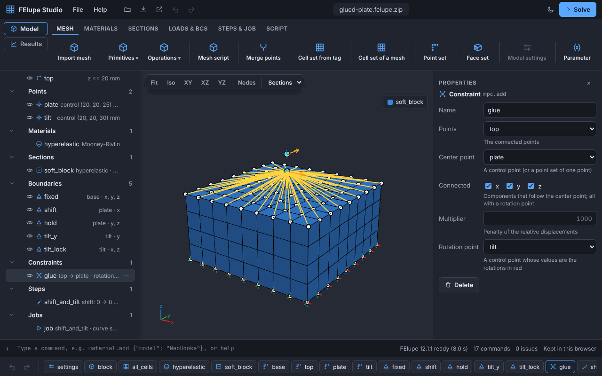

- **Header:** the menus **File** (new, open, samples, save and the exports) and **Help** (this guide, the command reference, the keyboard shortcuts and *About* with the versions of FElupe, Python and Pyodide), buttons for Open, Save, Export, Undo and Redo, the **theme** and **Solve**.
- **Ribbon:** the workspaces **Model** and **Results**. The tabs of the model create its objects in the order in which a model is usually built: Mesh, Materials, Sections, Loads & BCs, Steps & Job. A button that cannot be used yet tells you what is missing, e.g. "Create a cell set and a material first."
- **Model browser** (left): the objects of the model in groups. A number at an object counts its issues. A click on an object selects it in the viewport and opens its **properties**, where you edit and **Apply** or **Delete** it. After a change, **Apply** (Enter) takes it over and **Reset** (Esc) discards it; an issue of the object is shown at its field, e.g. a missing material at *Material*. The tooltip of a symbol, e.g. C₁₀, names its key in the project file (`C10`). A right click on an object, its **⋯** button or Shift+F10 opens its menu: **Duplicate** (Ctrl+D) creates a copy with the next free name, e.g. `soft_2`, right after the original and selects it, so a second material or boundary that differs in one value is quick to make; objects that use the original keep using it. The menu of a mesh has **Export mesh…**: the mesh as the model uses it, also the mesh of a script with the current parameters, as a VTU, VTK, Gmsh, Abaqus or Nastran file with its solid cells and their tags, e.g. for ParaView or another solver. **Rename** (F2), **Show/Hide** (H) and **Delete** (Del) work on the selected object too.
- **Viewport:** the meshes with their point sets, face sets, boundaries, symmetry planes, control points, rigid surfaces, contacts, constraints, point loads and pressures. The toolbar has the views, *Fit*, *Color by* (mesh, cell set or section), *Nodes* and *Cut*.
- **Cut** in the toolbar of the view cuts the model by a plane normal to x, y or z, so you see inside it, e.g. the rubber of a bushing between its sleeves. *Cut x* (or y, z) puts the plane at the middle of the model; *Hide x >* hides the half beyond it, a click hides the half before it instead (*Hide x <*). The field takes a coordinate, and the slider moves the plane over the model: the cut follows when the slider stops. The cut face shows the cells inside, in the colors of their sections or cell sets. What is in the hidden half is not drawn: the points of point sets, the control points and the symbols of boundaries and loads; lines, face sets and rigid surfaces end at the plane. Clicks pick the faces of the model as without the cut, a click onto the cut face picks nothing. A 2D model is cut by x or y only. If the cut of a mesh fails, the viewport says so below the view, e.g. *soft_mesh: the cut failed with …*, and draws the mesh whole, or with its cut before. The cut is a setting of the view, the same in the Model and the Results workspace; it is not saved with the project, and another project starts without it. *No cut* shows the whole model again.
- **Footer:** the command line, the state of Python, the number of commands and issues, and the history: the commands in their order, with Undo (Ctrl+Z) and Redo (Ctrl+Shift+Z).

In narrow windows (up to 1000 px, e.g. a tablet or a small laptop window), the browser and the properties are drawers over the viewport: the button left of the logo opens the browser, a selection opens the properties, Esc closes them. The ribbon is one row that scrolls.

On a phone, and in short windows (up to 600 px wide or up to 500 px high, e.g. a phone in landscape), the layout is **compact**, so that the viewport gets most of the height and the page does not scroll:
- The header is one row. Undo and Redo are in the history bar, and on a phone in portrait, Open and Export are in **File**.
- **Model** and **Results** are two icons in the row of the tabs; their names are their tooltips. The tabs are one row that scrolls.
- The commands of a tab open when you tap the tab, and close after a command or when you tap the tab again, so the view gets their height back.
- The command line is behind its button beside Undo and Redo, and the status is one line with the issues.
- **Results:** the contour, *Play* and the substep are one row, with the number of the substep beside its slider. **More controls** (the button at the end of the row) opens the others below it: the job, *Back and forth*, the speed, the values of the substep, the scale, *Undeformed*, *Curve* and *Live results*. In landscape, the row is beside *Model* and *Results*.
- The toolbar of the view is one row that scrolls.
- The curve and the card *Control points* are off at first, so that the view has the space: turn them on with *Curve* and with *Points* in the toolbar. They take the bottom of the view in portrait and its right side in landscape; the view gets smaller rather than covered.
- The app keeps out of the notch and the home indicator of a phone.

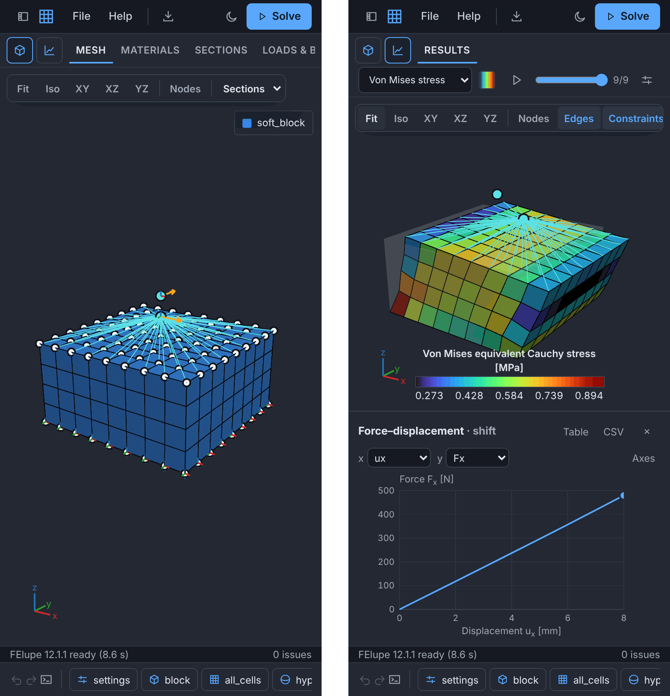

The project is kept in the browser with its mesh files: a reload restores it. To keep it elsewhere, save it.

The button left of **Solve** chooses the **theme**: *Dark* (the default), *Light* or *System*, which follows the color scheme of the system or the browser. The choice is a setting of the browser, not of the project, and the app starts in it after a reload, also in other tabs. The bar of the browser or of an installed app takes the color of the theme. In the light theme, the background of the viewport is white, and so is the picture of the view (*Export ▸ Picture of the view*), e.g. for a report. The symbols in the view are darker there, so they stand out on white: e.g. the selected object in dark yellow instead of yellow, the control points and the constraints in dark cyan, the loads in dark pink. The colors of the meshes, cell sets and sections are the same in both themes.

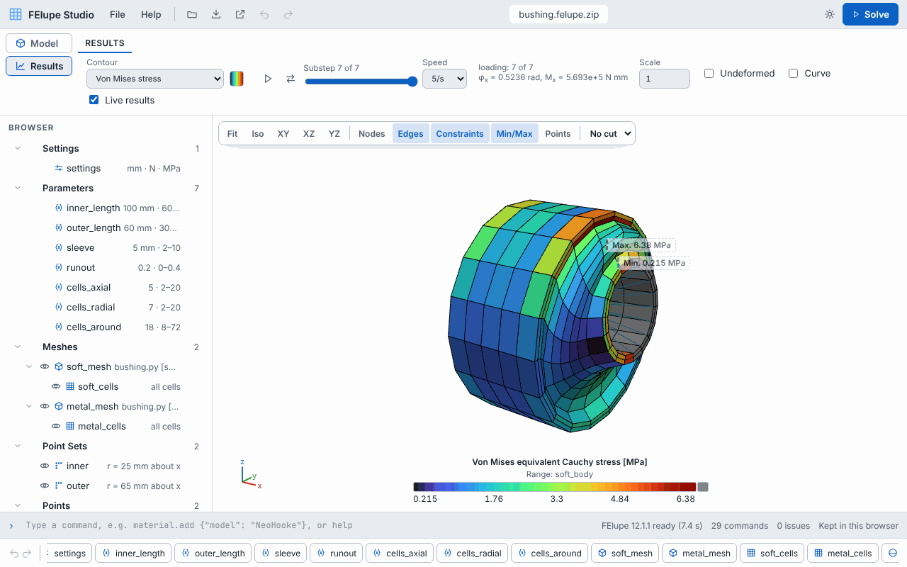

For a **picture in a report**, take the light theme. For the model, give the sections colors of their own, e.g. the rubber in black and the steel in gray, and color the view by sections ([1. Mesh](#1-mesh)). For the results, take the range of the part that matters, e.g. of the rubber (*Range of* in the [contour settings](#results)), with the other sections in one color or hidden (*Other sections*), and *Grayscale* for a printer. *Export ▸ Picture of the view* writes a PNG on white, with the legend or the scalar bar.

### Save and open

A project is saved in one of two formats; the header shows its name with the suffix:

- a **project file** (`.felupe.json`): the commands as text, e.g. for version control. Keep it next to its mesh files and open them together.
- a **project archive** (`.felupe.zip`): one ZIP file with the project and its mesh files, to open it anywhere in one step. Any tool unpacks it; with the Python script inside, the unpacked folder runs with `python <name>.py`.

**Save project** (Ctrl+S) saves in the format of the project without asking. A project opened from an archive or a sample is an archive, one opened from a project file stays a project file, and a new project becomes an archive with its first mesh file. **Save project as…** (Ctrl+Shift+S) chooses the name and the format, for an archive also *Include the Python script*, and lists the mesh files with their sizes (a mesh file that is not loaded is missing in the archive). To **rename** the project without saving, click its name in the middle of the header (or **File ▸ Rename project…**), type the new name and press Enter; Escape keeps the old one. The format stays; the next save and the exports take the new name, and the project counts as not saved (•) until it is saved under it.

**Where the files go:** in Chrome and Edge on the desktop, saving opens the **save dialog** of the system: choose the folder and the name, and the file is written there. It suggests the name of the project and opens in the folder of the last saved project; the exports keep a folder of their own. A name chosen there is the name of the project, and **Save project** then writes into the same file again without asking, as long as the project is open. *Save project as…* asks every time, first for the format in the dialog of the app, then for the place in the save dialog. A renamed or a new project, a project opened from a file or a sample, and a reload ask again on the next save: the app keeps the file in memory only. *Cancel* in the save dialog saves nothing. Firefox and Safari have no such dialog: there, the app downloads the files into the download folder, with the name of the project. To be asked where to save each download, turn on the setting of the browser for it, e.g. *Always ask you where to save files* in Firefox or *Ask for each download* in Safari. Chrome and Edge refuse the dialog where the site setting *File editing* or a policy of the browser blocks the editing of files, e.g. on a managed computer: then the app downloads the files too, and says so once (#439). After a change of the setting, reload the page. The hint of *Save project* in the *File* menu says where it saves: into the file of its last save, in the save dialog, or as a download.

**Open project** (or a drop on the window) opens a project file with its mesh files, an archive, also a folder of a project that you zipped yourself, or mesh files to import; files of an archive that the project does not use are listed and not opened. Opening a project replaces the mesh files of the previous one; with unsaved changes, the app asks first. A project file of an older schema version is migrated when it opens. A project saved with a newer version of FElupe Studio may use what this version does not know, e.g. a mesh tool or a property of a command: the app says so (*This project uses …, which FElupe Studio … does not know*), and an update of FElupe Studio opens it.

## Samples

An empty model shows a welcome panel with *Import mesh*, *Open project* and the samples; **File ▸ Samples…** lists them too. A sample opens as a ready-made model with its mesh files. They show the features step by step:

| Sample | Shows |
| --- | --- |
| Bar of two materials | cell sets from a cell tag of a VTU file, the `u` and `u-p-J` formulations, a force-displacement curve |
| Material test: uniaxial tension | a load case with symmetry planes, compared with the analytical curve |
| Hexahedrons and tetrahedrons | a Gmsh file with two types of cells |
| Mount in shear | three sections, the Mooney-Rivlin model, the shear load case |
| Hyperelastic block with a rigid plate | control points, a multi-point constraint with a rotation point, a step with several ramps |
| Sandwich spring with parameters | parameters, a mesh made by a Python script, point sets at the bounds of the meshes, the shear and the increments as expressions of the parameters |
| Axisymmetric sandwich spring | an axisymmetric model of the sandwich spring, its section made by a 2D mesh script, the force over the circumference |
| Plate with a hole in plane strain | a plane strain model, two symmetry planes, the concentration of the stress at a hole |
| Elastic-plastic plate with a hole | a strain-based elastic-plastic material (steel), loading beyond the yield stress and unloading, the equivalent plastic strain |
| Bushing with steel sleeves (FElupe ex05) | a mesh script with the fineness of the mesh as parameters, point sets on cylinders, a rotation point for torsion and tilt |
| Bushing made with mesh tools | the bushing with its meshes made by the mesh tools in the app: lines filled between, runouts, revolved sections, expressions of the parameters |
| Bushing with the Mullins effect | a filled rubber that softens after its first loading, a radial load cycle with a repeated step, the maximum strain energy density |
| Hyperelastic spring with end stops (FElupe ex06) | rigid surfaces, contacts with friction, a point set on the outer surface, a symmetry plane |
| Metacone (FElupe ex15) | an axisymmetric rubber-metal spring, its section made by a 2D mesh script with runouts, the clamped uniaxial load case |
| Engine mount (FElupe ex07) | plane strain, air as a third medium (`u-isochoric`), rigid metal parts by point sets of sections, two jobs |

Open a sample, press **Solve** and look at the results; then change a value in the properties and solve again. A build of the app of your own can have other samples from a folder, e.g. private ones, or run under your own name ([your own deployment](deployment.md)).

The **hyperelastic spring with end stops** is the example ex06 of FElupe: a half of a spring (the symmetry plane `y = 0`) bonded to two steel plates. The top face is fixed; the bottom face is compressed by 40 mm in z and then shifted by 40 mm in x. The plates are also end stops: two rigid planes, `upper_plate` and `lower_plate`, and the contacts `upper_stop` and `lower_stop` with a friction of 0.5 take the points of the point set `outer` (*On the outer surface*). The reference point of the lower plane is on the plane `z == 0` of the point set `bottom`, so the boundaries of the bottom face move the plane with it, and the curve is the force of the whole lower plate. It rises steeply once the bulging spring touches the upper plate; the card *Control points* shows the force of the end stop. The upper plane is 0.1 mm above the top face, like in ex06, and fixed by its own boundary.

The **engine mount** is the example ex07 of FElupe in plane strain: rubber (`u-p-J`) between an inner and an outer metal part, with air in its cavities, on the meshes of ex07. The air is a Neo-Hooke material without a bulk modulus in the formulation `u-isochoric`: it has no volumetric part, so it is soft for any change of its volume, a third medium that only keeps the rubber from penetrating itself. The metal parts are rigid: the point sets `inner` and `outer` take all points of their sections (*Of a section*), and boundaries move all of them, so their stiffness does not matter. The job `vertical` moves the inner part by 3 mm in y, the job `horizontal` then by 8 mm in x, there and back (three steps); the second job starts from the state of the first. The forces are per unit thickness (ex07 plots them for a thickness of 100 mm).

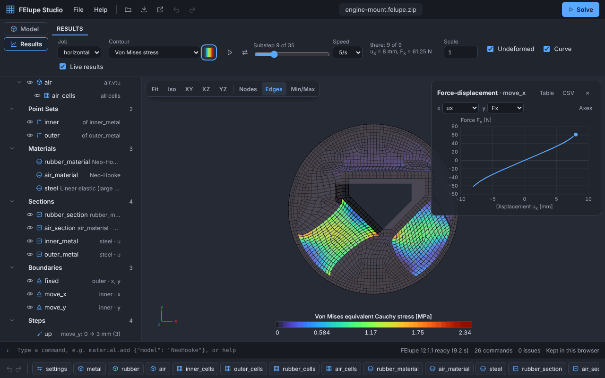

The **metacone** is the example ex15 of FElupe, a conical rubber-metal spring as an axisymmetric model (x is the axis): two rubber layers (`u-p-J`) between three steel sheets. Its script `metacone.py` makes the section with the mesh tools of FElupe, like ex15: lines expanded and filled between, runouts at the free ends of the rubber layers, rotated by 15° to the cone. The clamped uniaxial load case `push` moves the end of the inner sleeve by -1.5 mm along the axis and holds the end of the outer sleeve; the force is the total over the circumference, about -517 N at the end. The parameters change the thickness of the sheets and the fineness.

The **sandwich spring** is a parametric sample: hyperelastic discs between steel sheets, the base sheet fixed and the top sheet sheared by half of the height of the soft layers. Its mesh comes from the script `sandwich_spring.py`, which gets the parameters *radius*, *layers*, *height*, *sheet*, *cells* (the fineness of the discs) and *cells_height* (the cells through a soft layer; a sheet has one cell through its thickness) and makes a dict of a soft and a metal mesh on the same points. The step of the shear has expressions of the parameters: the end of the ramp `0.5 * layers * height` (12 mm for 3 layers of 8 mm) and `2 * cells` increments. Opening it asks for the values first: with 5 layers instead of 3, the stack is higher and the spring is softer by about 3/5, so it is sheared by 20 mm to the same shear strain with about the same force. The point sets `base` (`z == min`) and `top` (`z == max`) and the shear follow the parameters without a change. The top sheet is guided by two boundaries, `guide_y` and `guide_z`: a ramp of `guide_z` in the step compresses the spring while it is sheared.

The **axisymmetric sandwich spring** has the same parameters, but its script `sandwich_spring_2d.py` makes the section of the discs and the sheets in the xy-plane: x is the axis, y the radius (*cells* along the radius). The first sheet (`x == min`) is pressed by 4 mm along the axis against the fixed last sheet; the axis is a symmetry plane `y = 0`. The force of the curve is the total over the circumference. The **plate with a hole** is a quarter of a square hyperelastic plate in plane strain, made by `plate_with_hole.py` from the radius of the hole, the half width and the fineness; the symmetry planes `x = 0` and `y = 0` and a pull of the end by 8 mm load it, and the contour of the largest principal stress shows the concentration at the top of the hole. Its force is per unit thickness.

The **elastic-plastic plate with a hole** is the same quarter of a plate in steel: *Elastic-plastic, isotropic hardening* (E = 210000 MPa, ν = 0.3, σy = 250 MPa, K = 1000 MPa) in the framework *Small strain*, with the formulation `u`. The step `loading` pulls the end by 0.1 mm, the step `unloading` brings it back to the start. The stress at the hole yields first, then the plastic zone grows across the net section and the curve bends over. The unloading is elastic, with the stiffness of the start, and crosses zero force at the remaining elongation of about 0.054 mm; before the plate is back at the start, it yields again in compression. The contour *Equivalent plastic strain* shows the plastic zone at the hole.

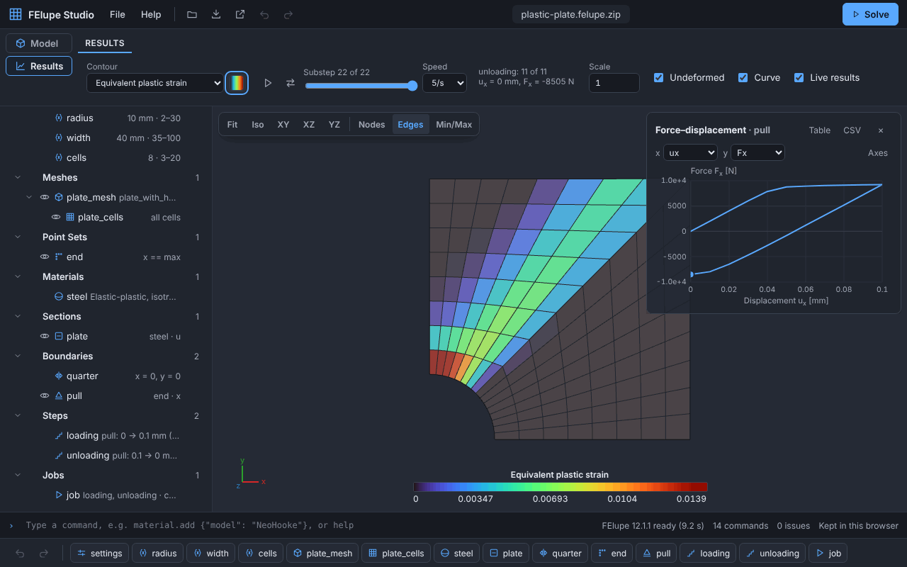

The **bushing with steel sleeves** is the example ex05 of FElupe: a hyperelastic body between two steel sleeves, made by `bushing.py` with the lengths of the sleeves, their thickness, the runout of the free faces and the fineness of the mesh (cells along the axis, through the soft body and around it) as parameters. The outside of the outer sleeve (`r = 65`) is fixed; the inside of the inner sleeve (`r = 25`) is connected to a control point at the axis with a rotation point, which moves it by 8 mm in z, twists it by 30° about x and tilts it by −5° about y. The curve is the moment of the torsion over its angle. The multiplier of the connection (100000) is large compared with the steel, so the moment of the torsion agrees with ex05, which prescribes the rotated positions, within 0.1 %; a finer mesh is a change of three parameters.

The **bushing made with mesh tools** is the same bushing without a script: its meshes are made in the app with the mesh tools (see 1. Mesh). The section of the soft body is filled between two lines, embedded at the radii of the sleeves (`25 + sleeve` and `65 - sleeve`), gets its runouts and is revolved about the x axis; the sleeves are revolved rectangles. The browser shows each mesh with the meshes it is made of below it, hidden in the viewport. Change a parameter, e.g. *cells_around*, and the meshes are made again; select a tool to see its line in the script.

The **bushing with the Mullins effect** is the bushing made with mesh tools in a filled rubber: the material `filled_rubber` (Neo-Hooke, μ = 1 MPa) has the *Mullins effect* with r = 2, m = 0.05 MPa and β = 0.1, which the browser shows as *Neo-Hooke · Mullins*. The connection of the inner sleeve has no rotation point, and the job moves it radially in a load cycle: the step `load` by 6 mm, `unload` back to the start, `load` again (the same step) and `further` on to 9 mm. The force-displacement curve shows the softening: the unloading needs much less force than the first loading, e.g. about 45 % less at 3 mm, and the second loading follows the unloading back up to 6 mm, where it meets the first loading; above it, the rubber is as stiff as a new one. The contour *Max. strain energy density* shows where the rubber is softened, most at the ends of the outer sleeve in the direction of the load; it stays when the bushing is unloaded and grows only beyond 6 mm.


## Building a model

### Units

FElupe has no units: the numbers of a model only need to fit together, e.g. millimetres, newtons and megapascals. **Model settings** (last button of the *Mesh* tab, at most one per model) say which units the numbers mean: the length (mm or m) and the force (N or kN); the unit of stresses and moduli follows (MPa, GPa, Pa or kPa). The forms, the browser and the results then show the units, e.g. *E [MPa]* or *u = (8, 0, 0) mm*, and the script gets them as a comment. Nothing is converted: if you change the units, the numbers stay the same and only their meaning changes. Rotations are always in rad.

### Single precision

*Precision* of the **Model settings** builds a model in **single precision** (`float32`): the regions, the fields, the stresses and the linear system need half the memory, so a larger model fits into the memory of the browser, and it solves faster. Its accuracy depends on the model. After a run, the job panel shows an estimate of the round-off of the forces relative to the reaction forces, e.g. *Single precision: round-off 0.65 % of the reaction forces*; the curves usually deviate from double precision by about a tenth of it. From 1 % on, the panel warns: check such a model in double precision. Steel bonded to rubber is too stiff for single precision, e.g. the sandwich spring: its curve deviates by 4 %. Steel in mixed fields (*Mixed fields* or the *Three-field variation*) may not reach a tight tolerance of a job, e.g. 1e-6: FElupe 12.1.1 estimates its round-off too small (adtzlr/felupe#1305). Keep the default 0.01 or take double precision; rubber with its bulk modulus is not affected. The strain-based models of the registry, linear elastic and elastic-plastic, keep the linear system in double precision (their tangents in FElupe 12.1.1); a strain-based function of a file keeps it in single precision if its tangent has the data type of the strain, like its template. To save memory only in the factorization, with the results of double precision, choose the *Precision* of the linear solver of a job instead (see Steps and jobs).

### 2D models

*Analysis* of the **Model settings** makes the model 2D: **Plane strain** (a slice of a long body, the forces per unit thickness in z) or **Axisymmetric** (a body of revolution about the x-axis, y is the radius, the forces are the totals over the circumference). A 2D model has a mesh of triangles or quads in the xy-plane, e.g. of a mesh file or a mesh script with `fem.Rectangle`. Boundaries, point loads, symmetry planes and load cases then have x and y only; the viewport looks onto the xy-plane. The face sets of a 2D model are edges of quads: click a cell next to its edge, and *Create face set* takes the connected edges, e.g. for a pressure on the end of a cylinder. Rigid surfaces are lines and circles in the xy-plane, and contacts work as in 3D (in an axisymmetric model with a large *Multiplier*, e.g. 1000, as the penalty of a point does not follow its radius). Control points and multi-point constraints are in the xy-plane; a rotation point turns about z (in plane strain), so its boundary constrains z, the rotation about z, and the curve shows the moment Mz over the rotation φz.

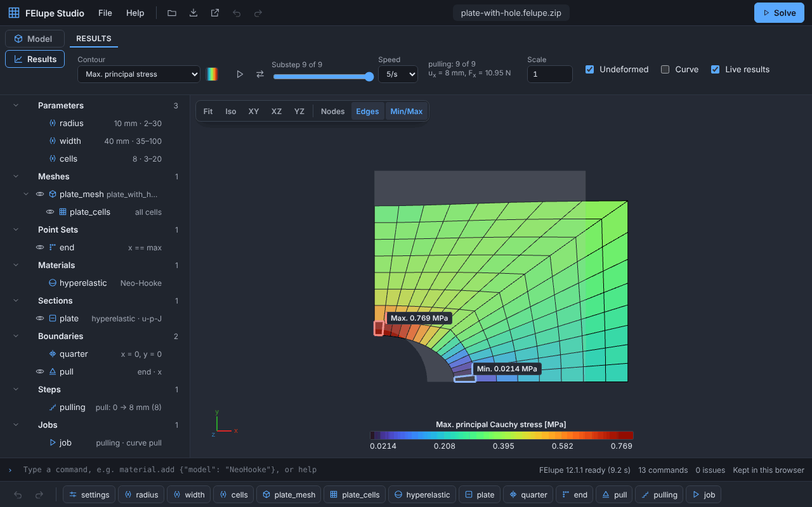

### Parameters

A **Parameter** (*Mesh* tab, next to *Model settings*) is a named number of the model, e.g. the radius of a disc or the number of soft layers. Its *Quantity* (length, force or stress) gives it the unit of the model settings; *Minimum*, *Maximum* and *Step* describe the values it may take, *Integer* makes it a whole number, and the *Description* says in a few words what it is. The browser lists the parameters below the settings, with their value and range; a value outside of the range is an issue of the parameter. The script defines the parameters as variables at its top, e.g. `radius = 50.0  # mm`, so you can change them there. A *Mesh script* gets them as variables (see Mesh). Opening a project with parameters shows their values first: change them (with a slider if they have a range) and *Open*, or *Keep the saved values*; the meshes of scripts are made after that. The dialog lists the scripts the project runs, with *Show* to read them first. Later, *All parameters…* in the menu of a parameter in the browser opens the same dialog; the changed values are one undo step.

A number of an object may be an **expression** of the parameters instead, e.g. `0.5 * layers * height` for the end of a ramp, `sheet + layers * (height + sheet)` for the coordinate of a point set or `2 * cells` for the increments: numbers, the names of the parameters, `pi`, `+ - * /`, `**` for a power, parentheses and the functions `sqrt`, `exp`, `log`, `sin`, `cos`, `tan` (radians), `abs`, `min` and `max`. Type it into the field (a leading `=` is fine); the field shows its value below it, e.g. *= 12 mm*. A list of numbers takes expressions separated by commas, e.g. `0, 0, height`. A typo or a value out of range is an issue, e.g. *'layer' is not a parameter in '0.5 * layer * height'*. The browser and the script show the expression as written, e.g. `fem.math.linsteps([0, (0.5 * layers * height)], num=(2 * cells))`, so the model and its script follow a changed parameter: the point sets, the arrows and the ramps move with it. Renaming a parameter renames it in the expressions; deleting it leaves them as issues. The dialog of the parameters says which objects use a parameter, and warns of the problems of the expressions with the new values, e.g. too few increments.

A **derived parameter** is a parameter whose *Value* is an expression of other parameters, e.g. `total_height` with `sheet + layers * (height + sheet)`: define a value that several fields use once, and use its name in their expressions. It is computed, not set, so it has no *Minimum*, *Maximum* and *Step*; the properties show its value below the expression, and the browser shows its value and its expression, e.g. `32 mm = sheet + layers * (height + sheet)`. Derived parameters may use other derived parameters, in any order; a parameter that depends on itself (also through others) is an issue, e.g. *'a' depends on itself through 'b'*. The dialog of the parameters lists them below the others with their expressions and their values, which follow the values you type; the script defines them after the others as their expressions, e.g. `total_height = sheet + layers * (height + sheet)  # mm`, and a *Mesh script* gets them too.

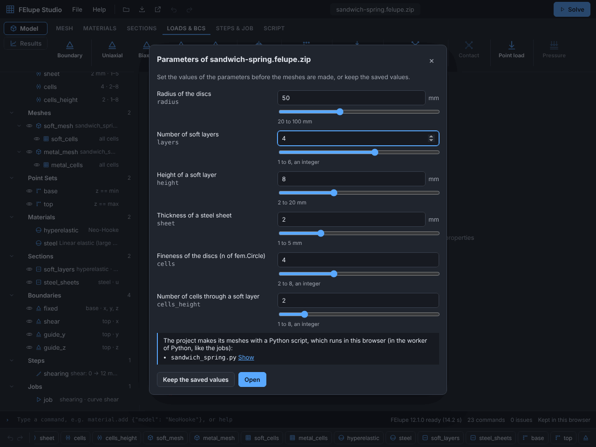

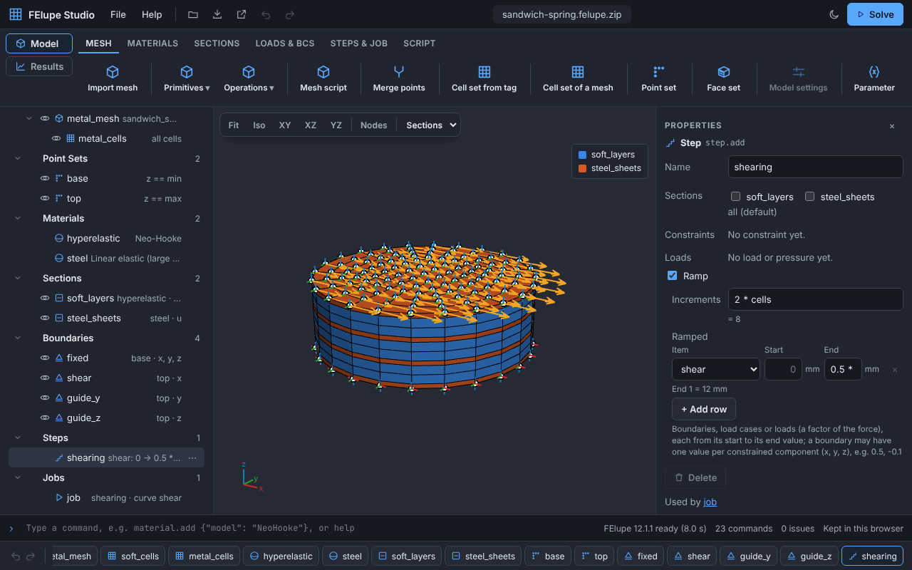

### 1. Mesh

**Import mesh** reads any mesh file that meshio reads, e.g. VTK (`.vtu`, `.vtk`), Gmsh (`.msh`), Abaqus (`.inp`), XDMF, Medit or Exodus; **Open project** accepts mesh files too. The solid cells are tetrahedrons or hexahedrons, linear or quadratic, or triangles or quads of a 2D model (see 2D models). A file with several types of cells gives one mesh per type. The dialog shows the size of the mesh; its *Scale* multiplies the coordinates, e.g. by 1000 for a mesh made in metres of a model in millimetres. The dialog suggests it if the mesh is very small or very large for the units of the model (smaller than 1 mm or larger than 10 m). Point sets and points use the scaled coordinates, so set the scale before you add them.

**Primitives** makes a mesh with a tool of FElupe, without a file: a **Point**, a **Line** along x, a **Rectangle** in the xy-plane or a **Cube**, between the corners *a* and *b* with *n* points per axis (at least 2). The values may be expressions of the parameters, e.g. *b* = `radius, 1, height` or *n* = `cells + 1, 3, 3`, and the mesh is made again when a parameter changes. The script has one line per mesh, e.g. `block = fem.Cube(a=[0, 0, 0], b=[2, 1, 1], n=[9, 5, 5])`. **Circle** and **Triangle** are quads in the xy-plane too. A circle has its *radius* and *centerpoint*, *n* points on the edges of a quarter and its *sections*, the start angles of its quarters in degrees: `0` for a quarter circle of a model with two symmetry planes, `0, 90` for a half, `0, 90, 180, 270` (the default) for a full circle; the quarters need 90 degrees between them. A triangle is made of three quad sections between the corners *a*, *b* and *c*, counterclockwise, with *n* points on the edges of a section; corners clockwise or on a line are an issue. A mesh of the dimension of the model (a cube in a 3D model, a rectangle, a circle or a triangle in a 2D model) is a mesh of the model with cell sets and sections. A lower one is a **construction mesh**, drawn in gray: a line as a line, a rectangle of a 3D model as a light face in the xy-plane, a point as a dot. It is no part of the model; a cell set of it is an issue. Construction meshes are the inputs of the operations of the mesh tools. **Export mesh…** in the menu of a made mesh writes it to a file, like an imported one.

**Operations** make a mesh of another mesh of the model (*Mesh*), made by a tool, imported from a file or made by a script: **Expand** along a new axis (a point to a line, a line to quads, quads to hexahedrons, with *n* points over the length *z*), **Revolve** about an axis (by the angle *φ* in degrees), **Embed** into one dimension more (the points get the coordinate *value* on the new axis, e.g. a line into the plane y = 30), **Translate**, **Rotate** (a mesh of 2D points turns about z), **Mirror** (at the plane normal to an axis, at a coordinate), **Fill between** two meshes (*Mesh 1* and *Mesh 2*, in this order: quads between two lines embedded in a plane, hexahedrons between two quad meshes in space, with *n* points from the first to the second), **Add runouts** (the concave free surfaces of a rubber body between metal parts: the points move perpendicular to the *axis* by the relative *values*, one per other coordinate, most at the *centerpoint*; *Normalize* keeps the shape of the ends) and **Stack**: two or more meshes of the same cells and points into one, with the points at the same place merged (their coordinates agree to *decimals*, 10 by default) and the cells of all of them. A new operation takes the latest meshes that no other tool takes yet, as many as it takes: a new *Revolve* takes the stack made before it, a new *Stack* all of them. For example, a rectangle expanded by 10 in z is a block of hexahedrons: `block = face.expand(n=5, z=10)`, and a circle of a 3D model expanded the same way is a cylinder: `cylinder = disc.expand(n=5, z=10)`. The profile of a rubber buffer with a flange, an L of three rectangles side by side, `stem`, `flange` and `rim`, stacked into one mesh is revolved at once, with one *n*, instead of each rectangle on its own: `profile = fem.MeshContainer([stem, flange, rim], merge=True, decimals=10).stack()` and `buffer = profile.revolve(n=19, phi=360, axis=0)`. A stacked mesh of rectangles is one mesh with one cell set of all its cells, so of one material; pieces of other materials, e.g. the sleeves of a bushing, stay meshes of their own, unless the meshes have cell tags (see below). A mesh of a file or a script is moved, rotated, mirrored or stacked like a made mesh, e.g. the half of a model from Gmsh, mirrored at its plane of symmetry and stacked with it into the whole: `other = half.mirror(normal=[1, 0, 0], centerpoint=[1.5, 0, 0])` and `bar = fem.MeshContainer([half, other], merge=True, decimals=10).stack()`. Its cells have the dimension of the model, so it is no input of *Expand*, *Revolve* or *Fill between* in a 3D model, except a **construction mesh of a file**: a profile of 2D cells, e.g. of Gmsh, imported into a 3D model with its cell type, e.g. `quad`, is a construction mesh like a rectangle, in the xy-plane (the z of the file is dropped), revolved or expanded into a body: `profile = volume_cells(meshio.read("profile.vtu"), cell_type="quad")` and `tube = profile.revolve(n=25, phi=360, axis=0)`. **Import mesh** offers it for a file of 2D cells in a 3D model, *Construction mesh, e.g. a profile to revolve or expand into a body*, without cell sets; the other choice is a mesh of a 2D model, which needs the analysis plane strain or axisymmetric in the settings. Its cell type is known once the file is read: a stack of its tetrahedrons with a cube is an issue then. A tool keeps the **cell tags** of the meshes it takes: a mesh of a file or a script imported with a tag, e.g. the half of a bushing from Gmsh with the physical groups `rubber` and `metal`, mirrored and stacked into the whole, has the tags of the half, so the cell sets of the tag values move to the whole: choose the whole as the *Mesh* of the cell set `rubber` in its properties, and its section takes the rubber of the whole. *Expand*, *Revolve* and *Fill between* repeat the tags per layer of cells, and *Stack* takes the tags of all of its meshes: a stack of a mesh without tags, e.g. a cube, has none (*cell set 'rubber' uses tag values, but mesh 'whole' is made by a tool of a mesh without cell tags: 'block'.*). A construction mesh of a file keeps its tag for the body that a tool makes of it: *Keep the cell tag for the body that a tool makes of it* of **Import mesh**, so a profile of Gmsh with the physical groups of its materials, revolved into a bushing, gives the bushing the tags for a cell set per material (*Cell set from tag* of the bushing). The script takes the tags with the helper `tags_of()`, e.g. `whole.tags = tags_of(whole, half, other)`, and the browser names the tag of a made mesh, e.g. *stack half, other · tag gmsh:physical*. A mesh that another tool uses is hidden in the viewport, like the history of a CAD model, and shown below the mesh that uses it in the browser; **Show** shows it again. An operation that does not fit its mesh is an issue, e.g. *expand needs a mesh of vertex, line or quad cells; 'block' has hexahedron cells*.

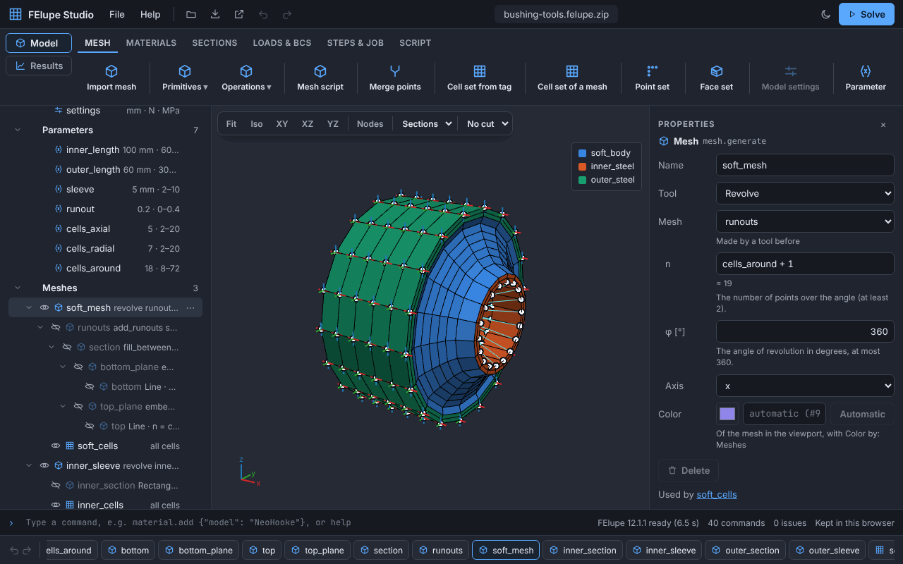


**Mesh script** makes a mesh with a Python script next to the project, e.g. with the mesh tools of FElupe. Open the script like a mesh file (**Open project**, or drop it); a script opened alone starts a new mesh script with it. The script gets the **parameters** of the model as variables (all of them, or the chosen ones) and makes a variable `mesh`: a `fem.Mesh`, a `fem.MeshContainer`, a `meshio.Mesh` or a dict of names and meshes, of which *Item* takes one, e.g. `soft`. For a soft and a metal part, make a dict and add two mesh scripts with the items. A changed parameter makes the mesh again; an error of the script is an issue of the mesh, and its properties show the traceback. The script is kept with the project like a mesh file, also in archives, and the generated script runs it with `run_mesh_script()`, so it needs the script in its folder.

```python
import felupe as fem

# the parameters of the model, or these values if the script runs alone
radius = globals().get("radius", 50)
layers = globals().get("layers", 3)
height = globals().get("height", 8)

disc = fem.Circle(radius=radius, n=6)
mesh = {"soft": disc.expand(n=layers + 1, z=height)}
```

The lines with `globals().get()` are optional: they give the script values of its own, so it also runs alone (`python disc.py`) and linters know the names.

A part that is **empty** for some values of the parameters, e.g. a sandwich spring without its steel sheets, is **one degenerate cell** of its cell type: all its points are one point. So the model keeps its mesh, cell set and section. A cell without volume has forces and stiffness that are not numbers, so its section is **off in every step** (#429): the steps leave out a section without volume (V = 0), also a step that lists it in *Sections*, and the properties of the steps show it grayed out (*no volume (V = 0): off in every step*). A value of the parameters that gives the part a volume again switches it on again, as the steps say. The generated script does the same when it runs, so it also runs with other values of the parameters. The point of the degenerate cell is yours: put it on a point of another part, which it is merged with, or hold it with a boundary. It also counts for the bounds of point sets, e.g. `z == min`. E.g. a parameter `sheets` (0 for none) and these lines at the end of the script of the sandwich spring of the samples: with one soft layer and without sheets, it gives the same force as a model without them.

```python
# without sheets: one degenerate cell on a point of the soft layers
if sheets == 0:
    soft = mesh["soft"]
    mesh["metal"] = fem.Mesh(
        points=soft.points[soft.cells[:1, 0]],
        cells=np.zeros((1, 8), dtype=int),
        cell_type="hexahedron",
    )
```

A mesh without cells is an issue of its mesh, e.g. *The mesh 'metal' of 'sandwich_spring.py' has no cells. Make an empty part one degenerate cell of its cell type, …*; FElupe cannot make the fields and the solid body of a section without cells. The properties of a section without volume say *Volume 0 (V = 0): off in every step.* Its strains and stresses are not numbers: the contours, the ranges, *Min/Max* and the hover skip them, and the exports write them as NaN. Only the steps of a model with mesh scripts leave out a section without volume; of a model without them, e.g. of a mesh file with a degenerate cell, leave it out of the steps yourself.

The cells of a model come from **cell sets**: **Cell set of a mesh** takes all cells, **Cell set from tag** the cells with a value of an integer cell data array (the *Cell tag* of the import, e.g. `material` or `gmsh:physical`). The meshes are merged at their common points; **Merge points** also merges points that agree to a number of decimals, e.g. of meshes from different programs.

Every mesh, cell set and section has the color of its position among the objects of its kind in the viewport (*Color by: Meshes*, *Cell sets* or *Sections*). Its *Color* in the properties gives it a color of its own instead, e.g. steel in gray and rubber in black: pick it, or type it as `#rrggbb`; *Automatic* takes the color of its position again. The legend and the pictures of the view take it, and a duplicated object keeps it. The other objects keep the colors of their positions. Construction meshes of the mesh tools stay gray.

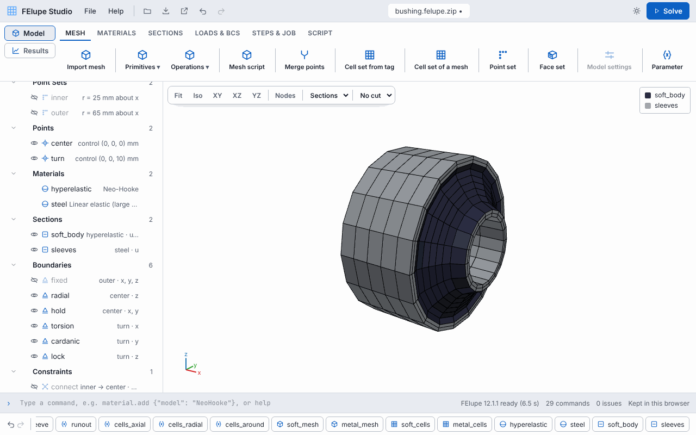

### 2. Materials and sections

The **Materials** tab has the material models in three menus by their kind: *Linear elasticity* (*Linear elastic (small strain)* for small displacements and rotations, *Linear elastic (large strain)*), *Hyperelasticity* (Neo-Hooke, incompressible or compressible with λ; Mooney-Rivlin, Yeoh, third-order deformation; Ogden with one to three terms: the moduli μᵢ and the exponents αᵢ as lists, e.g. `1, 0.2` and `1.7, -1.5`; Arruda-Boyce, extended tube) and *Strain-based elasticity* (linear elastic, and elastic-plastic with isotropic hardening). The hyperelastic models have an optional bulk modulus K: without it they are incompressible and need the `u-p-J` formulation of a section; the defaults are the examples of the FElupe documentation. A **Section** assigns a material and a formulation to a cell set; the **Sections** tab has a button per formulation, which takes the latest material that fits it: *Displacement (u)* with the displacements only, the menu *Nearly incompressible ▾* for (nearly) incompressible materials, and *Isochoric part only (third medium)*. The hint below *Formulation* says when to use a formulation. The menu *Nearly incompressible ▾* has four ways of `u-p-J`, with the displacements, the pressure p and the volume ratio J:

- *Automatic* (`u-p-J`), the default for a material without a bulk modulus: condensed per cell of linear hexahedrons and quads, mixed fields of the other cells.
- *Condensed per cell* (`u-p-J-condensed`): p and J are constant in every cell and condensed, so the system has the displacements only (Q1/P0, and Q2/P0 of quadratic cells). It takes hexahedrons and quads, linear or quadratic; a section of tetrahedrons or triangles has an issue that blocks *Solve* and names the ways that take them, e.g. *Condensed per cell (u-p-J-condensed) takes hexahedrons and quads, not the tetra cells of 'rubber'. Use 'u-p-J' or 'u-p-J-mixed'.*
- *Mixed fields* (`u-p-J-mixed`): p and J are unknowns of the system, of every cell type, also of linear hexahedrons and quads (constant per cell); linear tetrahedrons and triangles get a bubble point (MINI). On quadratic hexahedrons (`hexahedron20`) it gives the curve of *Condensed per cell*, on `hexahedron27` and `quad9` p and J are linear in a cell.
- *Three-field variation* (`u-p-J-three-field`): the mixed fields with the volumetric part of the material itself, so it takes any material with a volumetric part of its own: a hyperelastic model with its bulk modulus, a compressible or a strain-based model, also elastic-plastic. The section has no bulk modulus. It is the slowest way, up to 1.3 times the time of mixed fields ([benchmarks](benchmarks.md#the-ways-of-u-p-j-420)), and with the model in single precision a tight tolerance of the job may not be reached for steel (see Model settings).

*Automatic*, *Condensed per cell* and *Mixed fields* take a material without a volumetric part of its own, a hyperelastic model without its bulk modulus, and add the volumetric part with the bulk modulus K of the section; with a compressible model or a bulk modulus of the material, *Formulation* shows an issue, which blocks *Solve* and names the formulations that fit, e.g. *Use the displacement formulation 'u' or 'u-p-J-three-field'*. *Isochoric part only (third medium)* (`u-isochoric`) takes a model without a bulk modulus as it is, without a volumetric part: its volume changes freely, e.g. of air as a third medium in the cavities of a rubber part. The *Volumetric part* of a section with a bulk modulus is the strain energy U(J) of the volume ratio J: *Volume ratio* K/2 (J − 1)² (the default), *Stretch* 9K/2 (J^⅓ − 1)² or *Logarithm* K/2 ln(J)². With a large bulk modulus (nearly incompressible) J stays close to 1 and the choice hardly matters; with a small one, e.g. of a foam-like or a compressible soft material, it changes the response. Every section becomes a solid body. A section has a *Color* of its own like a mesh (above), for *Color by: Sections*, the default of a model with sections, e.g. the rubber in black and the steel sleeves in gray.

**Strain-based materials** (`fem.MaterialStrain`) are given by a stress in terms of a strain instead of a strain energy, e.g. for metals: *Linear elastic*, and *Elastic-plastic, isotropic hardening* with von Mises plasticity, the yield stress σy and the hardening modulus K (the yield stress grows by K times the equivalent plastic strain). Their *Framework* says which strain and stress they take: *Small strain* (the default) for small displacements, *Total Lagrange* (the Green-Lagrange strain) for large rotations with small strains, *Co-rotational* (the Biot strain of the stretch) or *Seth-Hill* with a *Strain exponent m*, e.g. 0 for the logarithmic (Hencky) strain, for large strains. Their parameters are Young's modulus E and Poisson's ratio ν; the defaults are a steel in MPa. A section with a strain-based material needs the formulation `u`. Plasticity depends on the path: to unload, add a step whose ramp goes back, e.g. from *Start* 0.5 to *End* 0.3 of the same boundary. The force-displacement curve then shows the elastic unloading, and the deformation that remains at zero force is the plastic one; the contour *Equivalent plastic strain* shows where the material yielded. The sample *Elastic-plastic plate with a hole* shows it.

**The Mullins effect** of filled rubber: *Mullins effect* in the properties of a hyperelastic material (Neo-Hooke, Mooney-Rivlin, Yeoh, third-order deformation, Ogden, Arruda-Boyce) makes it softer after its first loading, the pseudo-elastic model of Ogden and Roxburgh. When it is unloaded and loaded again, it is softer up to the largest strain energy density it had so far, and as stiff as before above it. *r* (> 1) sets the largest softening: with r = 2, the stress drops at most to half; *m* (a strain energy density, like a stress) and *β* set how fast it softens below the largest strain energy density, with smaller values for more softening. The bulk modulus is not softened. The browser shows the material as e.g. *Neo-Hooke · Mullins*. The effect needs a load history: a job whose steps unload and load again, e.g. *load*, *unload*, *load* (a step may come again in a job). The contour *Max. strain energy density* shows where and how much the material was loaded; the sample *Bushing with the Mullins effect* shows it.

**User-defined materials** ([ADR 0025](adr/0025-user-defined-materials.md)): the menu *User-defined* in the Materials tab has the materials of a Python file next to the project, like a mesh script (below): a *Constitutive model (Python)*, a *Strain energy function (Python)* or a *Strain-based function (Python)*. Type the name of the file in *Script* and choose the file in the properties of the material (*Choose file…*). The project keeps it like a mesh file, also in archives, and the dialog of an opened project lists it with the scripts of the meshes. The browser shows the file of the material, e.g. *soft.py*. The app runs the file once before a job, and again for a new version of it or new values: its properties say what it made, e.g. *umat: NeoHooke · no state variables*, and an error of the file is an issue of the material that blocks *Solve*, with the traceback of the file below *Traceback of the script*. *Download template* in the properties saves a minimal file of its kind under the name of *Script*, to edit and choose it. The results have the strains and the stresses as for any material; the contours of state variables are those of the models of the registry and of the Mullins effect.

- **A constitutive model:** the file runs with the parameters of the model as variables (all of them, or those of *Parameters*) and makes a variable `umat`: any constitutive model of FElupe with the methods `gradient` and `hessian`, e.g. `fem.NeoHooke(mu=mu, bulk=bulk)`, a strain energy function of tensortrax with a volumetric part, `fem.Hyperelastic(fem.mooney_rivlin, C10=0.4, C01=0.1) & fem.Volumetric(bulk=bulk)`, or an object of a class of your own. *Volumetric part* says whether `umat` has a volumetric part of its own, e.g. a bulk modulus (on by default): like a model of the registry, the displacement formulation `u` takes a material with one and `u-p-J` one without, e.g. *Use the displacement formulation 'u' or 'u-p-J-three-field', or set 'volumetric' to false if its umat has none.* A job runs the file again with `run_material_script()` of the script. Its template, `felupe_studio/templates/material_constitutive.py`, is Neo-Hooke with `mu` and `bulk`, with the skeleton of a class with `gradient` and `hessian` as a comment.
- **A strain energy function** (#424): the file defines a function of the right Cauchy-Green deformation tensor `C` of tensortrax, e.g. `def strain_energy(C, mu):` (*Function*, by default `strain_energy`), and the material is `fem.Hyperelastic` of it, like the hyperelastic models of the registry: tensortrax computes its stress and its elasticity tensor. Once the file ran, the arguments of the function after `C` are fields of the material, each a number or an expression of the parameters, e.g. `mu` = `2 * G`; an argument with a default value in the function shows it and may stay empty. The function is the isochoric part of the strain energy (of the unimodular `det(C)^(-1/3) C`): without a bulk modulus *K*, the material needs `u-p-J`; with one, it has a volumetric part, `fem.Volumetric`, and takes `u`. The *Mullins effect* softens it like a model of the registry. A function with state variables takes them as its second argument `statevars` and returns the strain energy and their new values; *State variables* is their number. The run before a job evaluates the material at a deformation, so an error in the function is an issue with its traceback, e.g. *soft.py: NameError: name 'k' is not defined*, and so is an argument without a value or one that the function does not have, e.g. *soft.py: The function strain_energy needs a value of its argument 'mu'.* Its template, `felupe_studio/templates/material_hyperelastic.py`, is Neo-Hooke, `strain_energy(C, mu)`.
- **A strain-based function** (#425): the file defines a function of the strain, e.g. `def material(dε, εn, σn, ζn, E, nu, **kwargs):` (*Function*, by default `material`), and the material is `fem.MaterialStrain` of it in a *Framework*, like the strain-based models of the registry: *Small strain*, *Total Lagrange*, *Co-rotational* or *Seth-Hill* with its *Strain exponent m*. The function gets the increment of the strain `dε`, the strain `εn`, the stress `σn` and the state variables `ζn` of the last converged state, at every quadrature point of every cell, and returns the tangent `dσdε` (only if `kwargs["tangent"]` is true), the new stress `σ` and the new state variables `ζ`; its `**kwargs` take `tangent`. Once the file ran, its arguments after `ζn` are fields of the material, each a number or an expression of the parameters, e.g. `E` and `nu` of the template, which converts them into the Lamé constants itself; a value of an argument that the function does not have stays a field, to clear it. *State variables* are their shapes as a tuple of Python, like `statevars` of `fem.MaterialStrain`, e.g. `(1, (3, 3))` for the equivalent plastic strain and the plastic strain tensor (as in Python, `(3, 3)` are two state variables of three values, `((3, 3),)` one tensor); empty, the function has none. The material has a volumetric part, so a section takes it with `u` or the *Three-field variation*. The run before a job evaluates the material at a deformation: an error in the function is an issue with its traceback, and so are an argument without a value or one that it does not have, a function without `**kwargs` (*The function material takes no keyword argument tangent, which fem.MaterialStrain gives: end its arguments with \*\*kwargs.*), and state variables that do not fit, e.g. *steel.py: The function material returns state variables of the shapes (1,) and (3, 3), not those of statevars (0,). Set statevars to (1, (3, 3)).* A time-dependent function, with the time increment `dtime`, needs a value of it: a step gives none yet. The state variables are carried through a job, so a restored substep has its load history, but they are no contour: the equivalent plastic strain is a contour of the elastic-plastic model of the registry. Its template, `felupe_studio/templates/material_strain.py`, is linear elastic, `material(dε, εn, σn, ζn, E, nu, **kwargs)`, with a function with state variables as a comment.

### 3. Point sets

A **point set** selects points of the merged meshes:

- **by a picked surface:** click a face of the model. The viewport picks its *connected surface*: the faces of its section that are reached over shared edges, as long as the normals of two neighbouring faces differ by at most the *Angle* of the panel (30° by default; 60° for a coarse cylinder, 180° for the whole boundary; kept in the browser). *Create point set* stores the simplest selection of the surface: a plane normal to x, y or z, e.g. `z == 0` (at the smallest or largest coordinate of the meshes as that bound, e.g. `z == max`, so that it stays the top of the model when the mesh changes), a cylinder about an axis parallel to x, y or z, e.g. the inner sleeve of a bushing, or else its nodes. A plane or cylinder that would select more nodes than the surface has (a part of a plane) stores the nodes. A face of a mesh without a section picks its plane, if it is normal to x, y or z.
- **by combined surfaces:** further clicks add the surfaces of other faces, also of other sections, like `Mesh.select_surface_points()` of FElupe. A click on a surface cycles its state: the first click **picks** it, a second click **excludes** it (dark red) and a third one **deselects** it; a fourth click picks it again. The points of an excluded surface are removed from the selection, e.g. the points of an edge that a picked surface shares with a neighbour you do not want; excluded surfaces win over picked ones. The panel says what the next click does, e.g. *click again to exclude*. This works the same with a mouse, a pen and a touch screen. Shift+click cycles a single face the same way; a face of a picked surface is left out instead, and a second Shift+click takes it back. A **long press** (hold the pointer still for half a second) acts like Shift+click, e.g. on a touch screen without Shift; a ring at the pointer shows it. On the desktop, a **right click** deselects a surface at once, picked or excluded. A click beside the model keeps the picked surfaces; Escape or × clears them. The panel counts them, e.g. *3 patches · 1 excluded · 54 faces of body · 66 points*. With excluded points, the point set usually stores the nodes.
- **at a bound:** the points at the smallest or largest coordinate of the meshes of the sections along an axis (*At a bound*), e.g. the top plate of a spring whose height changes. Control points do not count.
- **on a cylinder:** the points at a distance (*Radius*) from an axis parallel to x, y or z through a *Center* (default the origin), e.g. the inner sleeve of a bushing.
- **on the outer surface:** all points on the outer surface of the meshes of the sections (of a 2D model on their outline), e.g. the points that may touch a rigid surface. Faces between two sections are inside; control points do not count.
- **by nodes:** turn on *Nodes* in the toolbar, click a node and Shift+click (or long-press) more nodes, then *Create point set*. A click on a picked node deselects it. The point set stores the coordinates of the nodes, not their numbers; *Copy* copies the coordinates.
- **by ids:** the ids of the points of the merged meshes, e.g. from a script.

A selected point set is highlighted in the viewport; if a plane, a bound or a cylinder selects no node of the meshes, the viewport says so (e.g. a wrong radius).

A **face set** (Mesh tab) selects faces of the boundary of a section, e.g. for a pressure: click a face and *Create face set* takes its connected surface, stored as the plane if it is all faces of the section on a plane normal to x, y or z, else by the centers of its faces; further clicks add surfaces, a click on a picked surface excludes it and a third one deselects it, and Shift+click cycles single faces, as for point sets. A face set has faces of one section: with surfaces of several sections, *Create face set* is disabled. The face sets are drawn as light faces, the selected one highlighted. FElupe has no faces of tetrahedrons yet: a face set needs a section of hexahedrons.

### 4. Boundaries and load cases

A **Boundary** prescribes displacement components of a point set: *Constrained* are the components, *Value* is the displacement (default 0; of a rotation point a rotation in rad): one number for all constrained components, or one per component separated by commas, e.g. `0.5, -0.1` for x and z, so one boundary moves a point set diagonally. Components that are not constrained are free. To fix some components and move others, use two boundaries, e.g. `hold` with y and z and `move` with x.

A **Load case** creates the boundaries of a standard test at once (uniaxial, biaxial, planar, shear), optionally with symmetry planes. A step ramps the displacement of its moving end faces.

A **Symmetry** (*Loads & BCs* › *Symmetry*) is a set of symmetry planes normal to x, y or z, like `fem.dof.symmetry`: on a plane, the displacement normal to it is zero and the displacements in the plane are free. *Planes normal to* chooses the planes, each at its coordinate (default 0). It holds in all steps and is neither ramped nor a curve. Use a load case for a homogeneous test of a cube or a bar (it has its own symmetry planes at x, y, z = 0), and a symmetry for a part: a half of a spring, a quarter of a bushing under a radial load, or a bar clamped at its ends (a load case without symmetry planes and a symmetry at the planes through its axis). A plane that a load case or another symmetry already has does no harm; the browser notes it. The viewport draws the planes like the boundaries and warns about a plane without nodes, e.g. a wrong coordinate.

### 5. Control points, rigid surfaces, contacts, constraints and loads

A **control point** is a point that is not a node of the meshes, e.g. the center of a rigid plate. *Control point at center* in the panel of a picked face, of picked nodes or of a selected point set creates one at the center of these points; then change its coordinates in the properties. A control point at the coordinates of a node is the node itself: the viewport warns about it.

A **Rigid surface** (Loads & BCs) is a plane or a cylinder through a reference point, e.g. a plate that presses a block or a roller: *Shape* is a plane with its outward normal (towards the model) or a cylinder with its radius, the direction of its axis and *Inside* for a tube around the model. The reference point is used like a control point: give it boundaries in all components, and a ramped boundary moves the surface. A boundary of a point set by a plane, by nodes or on a cylinder through the reference point moves it too, e.g. a plate that is bonded to the bottom face and is an end stop at the same time. The viewport draws a plane as a translucent rectangle with an arrow of its normal and a cylinder as a translucent tube; in the results they move with their reference points.

A **Contact** (Loads & BCs) lets the points of a face set (or a point set, e.g. *On the outer surface*) touch a rigid surface: they cannot pass it, and with a *Friction* coefficient they stick until the tangential force exceeds the friction. The penalty of the contact follows the stiffness of the sections at the points; a larger *Multiplier* lets them penetrate less, and an *Elastic slip* (a small length, about 1 % of a cell) sets how far sticking points may move before they slide. Move the rigid surface by a ramped boundary of its reference point and choose that boundary as the curve of the job: the curve is the contact force over the displacement of the surface, and the card *Control points* of the results shows the force at the reference point. A selected contact highlights its points and its surface. The sample *Hyperelastic spring with end stops* has two of them.

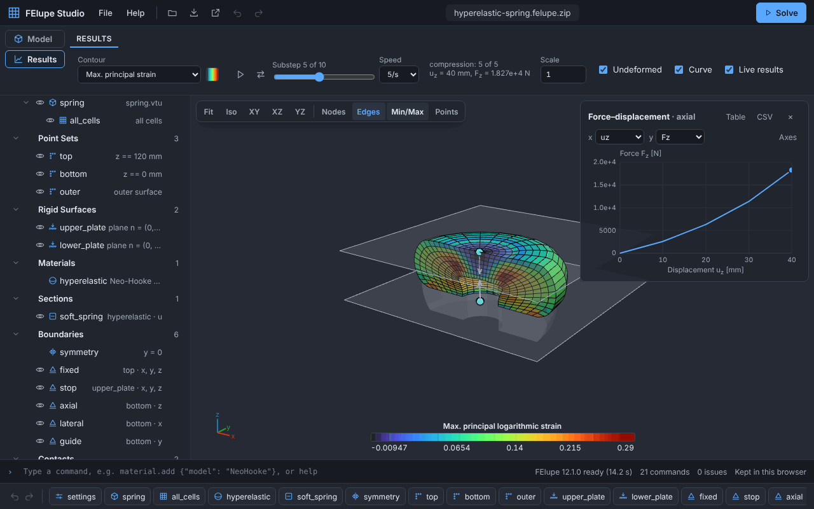

A **Multi-point constraint** connects the points of a point set rigidly to a center point (a control point or a point set of one point). *Connected* are the components that follow the center point. With a **rotation point**, the points also rotate about the center point: the values of the rotation point are the rotations about x, y and z in rad, so a boundary of its y component with the value 0.1 tilts the points by 0.1 rad about the y axis. The viewport draws lines from the center point to the connected points.

A **Cartesian constraint** holds or moves the points of a point set in the directions of a rotated coordinate system, e.g. a support on an inclined plane: the points slide on the plane and are held normal to it only. *e1* is the first direction, e.g. the normal of the plane, *e2* the second one, orthogonal to it (0, 1, 0 if empty), and e3 = e1 × e2; any length, the script normalizes them. In a 2D model, e2 is e1 turned by 90° about z, so a support on a line along e1 constrains direction 2. *Constrained* are the held or moved directions, the others are free. *Displacement* moves the points in these directions, one value or one per direction, and a step ramps it like a boundary, e.g. to press a part along an inclined axis. The constraint is a penalty: a larger *Multiplier* (1000 by default, a force per length per point and direction) leaves smaller gaps. Take about 100 times the stiffness of a cell at the points, its modulus times its size, e.g. 2e7 for steel cells of 1 mm in N and mm. It is an item of the steps like a multi-point constraint, and a step that leaves it out frees its points. As the curve of a job, it records the force of the solid bodies at its points over the displacement of its first point, both in its directions 1, 2 and 3: the curve shows F3 over the substeps of a support on a plane normal to e3, or F1 over u1 of a ramp in 1. The viewport draws its points like those of a boundary, along the rotated directions, and the selected constraint its coordinate system at the center of its points (e1 red, e2 green, e3 blue). Points that a boundary or a load case also prescribes in a component that is not normal to the constrained directions are over-constrained: the viewport warns about them, as for a multi-point constraint. A point set on an inclined plane is selected by nodes, e.g. the picked nodes of a face, or by its points; the coordinate system is fixed in space and does not turn with the deformation.

A **Cylindrical constraint** holds or moves the points of a point set radially (r), around (θ) and along (z) an axis, e.g. a rigid sleeve: its points slide on the cylinder and are held radially only. *Center* is a point on the axis (the origin if empty) and *Axis* its direction (0, 0, 1 if empty, any length); a new cylindrical constraint takes both from the latest point set if it is *On a cylinder*, e.g. of a picked cylinder. In a 2D model (plane strain), the axis is z through the center, with r and θ in the xy-plane; an axisymmetric model has no direction around its axis, so a boundary holds or moves its points radially (y) or axially (x). The directions are those of each point, and FElupe evaluates them in the deformed configuration: a point held radially stays on its radius also when it turns. *Displacement* moves the points in the constrained directions, one value or one per direction (r, θ, z), and a step ramps it like a boundary: radially e.g. a press fit onto a shaft, around the axis the arc length on the undeformed radius R of each point, so that the points turn by the angle u / R. A sleeve of the radius R turned by the angle φ takes u = R φ; points at different radii, e.g. the end face of a tube, turn by different angles, and a rigid turn of them takes a rotation point of a multi-point constraint. Points on the axis cannot be held radially or around it: the viewport warns about them, and the script raises an error. As the curve of a job, it records the displacement of its first point (u_r, u_θ as the arc length, u_z) and the sum of the forces of the solid bodies at its points, each in the directions of its point (F_r, F_θ around the axis and F_z): of points on one radius R, the moment about the axis is R F_θ. The curve shows the force over the displacement of its first constrained direction that moves, e.g. F_θ over u_θ of a torsion. The viewport draws its points like those of a boundary, along r, θ and z of each point, and the selected constraint its axis (blue, in 2D a cross at the center). The *Multiplier*, the steps and the over-constrained points are those of a Cartesian constraint.

A **control point needs a stiffness**: every component of it needs a boundary or a multi-point constraint. Otherwise the model has an issue, because the system of equations would be singular.

A **Point load** is a force at every point of a point set or at a control point. A ramp of a step scales the force from its start to its end value, so `end: 1` applies the full force.

A **Pressure** (Loads & BCs) acts on the faces of a face set, normal to the faces and per deformed area: a positive pressure pushes onto the faces, a negative one pulls. Like a point load, it is applied in full unless a step ramps it, and a ramp is a factor of the pressure. The viewport draws arrows onto (or away from) the faces.

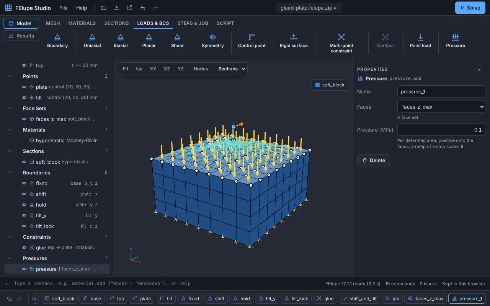

### 6. Steps and jobs

A **Step** solves the model in increments. Its items are the sections, multi-point constraints, Cartesian constraints, contacts, point loads and pressures (all of them, unless you choose some). *Ramped* lists the boundaries, load cases, Cartesian constraints, point loads and pressures whose values change in the step, each with its own start and end value (of a boundary also one per constrained component, e.g. `0.5, -0.1`, of a Cartesian constraint one per constrained direction); *Increments* is the number of substeps of the step. All other boundaries keep their values.

*Boundaries* chooses the boundaries, load cases and symmetry planes of a step (all of them, unless you choose some). A boundary that a step does not have is **off** in it: its points are free, and its reaction force is released at once, in the first substep. So a model can release a part that was held, e.g. open a clamp after a preload, fix a part only later, or hand a part over from a boundary to a contact. A boundary that a step has and the step evaluated before it does not have is **switched on**, also by the first step of a job after the last step of the job before it, and *Switched on* sets its values: *At the start of the step* (the default) holds its points where they are, and *At the start of the job* moves them back to where they were at the start of the job (in the first job the undeformed model, so the values of the boundary). A ramp of such a boundary in the step adds to these values, e.g. *Start* 0 and *End* 0.2 move its points by 0.2 from there. A step that ramps a boundary which is off in it is an issue, and a job whose *Curve* is off in some of its steps gets a note: its force is zero there. *Cutback* subdivides the ramp of a step, not a release, which happens in full in every attempt.

A section **without volume** (V = 0), e.g. an empty part of a mesh script as one degenerate cell, is off in every step of a model with mesh scripts: *Sections* of a step shows it grayed out, *no volume (V = 0): off in every step*, and keeps your choice for the values of the parameters that give it a volume (see *Mesh script* above).

The browser names what is off in a step: its boundaries, constraints, contacts and loads that it does not have, e.g. *no ramp · off: pull*. With the step selected, the viewport fades them, a contact by its rigid surface (if all contacts of the surface are off), and names them below the view, e.g. *Off in release (faded): pull*. So you see in the model what a step switches; the sections that a step does not have are not faded.

A **Job** evaluates its steps one after another. *Steps* is a list in order, a field per step: *+ Add step* adds the step after the last one, and a step may come again, e.g. *load*, *unload*, *load* for a load cycle, without a copy of a step; × removes one. With a *Curve* (a boundary, a load case, a Cartesian constraint or a point load) it records the force-displacement curve. *Tolerance* is the tolerance of the Newton-Raphson method: a substep has converged when the norm of the residual forces is smaller than this fraction of a reference force: the reaction forces, or the forces of a pressure or a contact on a solid body if they are larger (FElupe 12.1; below the round-off errors of the forces the criterion is absolute). It is 0.01 by default, like the force criterion of commercial codes: the forces deviate by much less than the accuracy of a hyperelastic model, at about half the time of FElupe's default (1.49e-8). Choose a tighter one, e.g. 1e-6, for curves that are fitted to test data or compared with a reference; as the Newton-Raphson method converges quadratically, this costs about one more iteration per substep. *Max. iterations* is the number of Newton iterations a substep may take (16 by default). *Cutback* retries a substep that does not converge with smaller increments: the increment is reduced by the *Factor* (0.5) up to *Max. cutbacks* times in a row (10) and grows again by *Growth* (2) after every converged increment. Leave these fields empty for the defaults (those of FElupe, except the tolerance); a smaller factor helps a substep that fails even after a few cutbacks. *Linear solver* chooses how the linear system of every Newton iteration is solved: *SuperLU (FElupe)*, the default and the right choice for most models; *spsolve (SciPy)*, the default of FElupe before v12; *PARDISO (local Python)*, Intel oneMKL on several threads for large 3D models, only with Python on your computer (see below); or an *Iterative (SciPy)* method, which needs less memory for large models but more care: *minres* for symmetric matrices (the default), *cg* only for positive definite ones (multi-point constraints with their penalties and the u-p-J formulation make the matrix ill-conditioned or indefinite), *gmres* or *bicgstab* otherwise. Its *Rel. tolerance* is by default the tolerance of the job divided by 100; if the method does not converge within *Max. iterations*, the job fails with a message, so allow more iterations or take a direct solver. *Precision* of a direct solver: *Single (float32)* solves the linear system in single precision, while the model and the forces stay in double precision. The factorization needs half the memory and is faster, so a larger model fits into the memory of the browser; the results are those of double precision, with a few more iterations at tight tolerances. u-p-J sections of tetrahedrons can be slower.

### 7. Solve

**Solve** runs the jobs. It is available when the model has a job, no issues and its mesh files; otherwise its tooltip tells you what is missing. The job panel shows the substep and the Newton iterations; *Cancel* stops the job. If a job fails, the panel shows the message and the Python traceback.

While a job runs, **Show live results** in the job panel (or the Results workspace) shows it **live**: the deformed model with the contour of the last converged substep and the curve growing with every substep, marked *Live · substep 7 of 20*. The scenes show the quantity that was chosen when you pressed Solve; a quantity chosen during the run applies after it. Substeps cannot be chosen until the run is over, then the results replace the live view. After a failed or cancelled run, the last live scene and the curve stay until the next run (*Failed after substep 7 of 20*). To save time on large models, clear **Live results** in the Results ribbon: the scenes take at most about a tenth of the time of a job, the curve always grows.

## Results

The **Results** workspace shows the deformed shape of a substep:

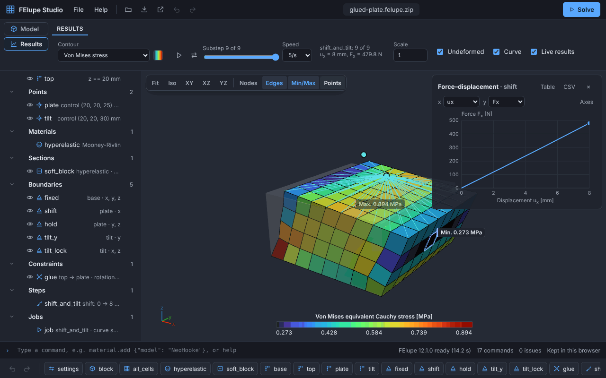

- *Contour*: the displacement, the logarithmic strains, the Cauchy stresses (principal values and von Mises) or, with an elastic-plastic material, the equivalent plastic strain, and with the Mullins effect, the *Max. strain energy density* of the load history, which shows where the rubber is softened (each zero in sections of other materials). The button beside it sets the **color map** (Turbo, Viridis, Cool–warm for signed values, centered at zero, or Grayscale for printing), **bands** (continuous or 6–20 discrete bands) and the **range**: of the substep, over all substeps of the job (to compare substeps), or manual, where values outside are drawn in an extra color. *Values at* chooses where the strains and the stresses are: at the *cells* (the mean of the quadrature points of every cell, constant in the cell, the default) or at the *points*, as a smooth contour: the *means of the cells* averaged at a point, *projected* (an L2 projection of the values of the quadrature points, closer to the peaks, e.g. at a hole) or *shifted* (the values of the quadrature points moved to the nearest point, for hexahedrons and quads; other cells are projected instead). The values at the points are per section: they jump between sections of different materials. At the points, the strain and the stress tensors are moved, and their principal values and the von Mises stress are evaluated there: so the von Mises stress is never negative, also next to a soft region like the air of the engine mount. The settings are kept in the browser and used by the picture export and the export of the results.
- **Range of** in the contour settings: in a model of a soft and a stiff material, the stresses of the stiff one set the automatic range, and the soft one, e.g. the rubber beside the steel, is one color at the low end of the scale. *Range of* takes the automatic range, of the substep or over all substeps, from chosen sections instead of *All sections*. The other sections are drawn in the colors of that range, their values outside of it in the extra color. *Min/Max* marks the minimum and the maximum of the chosen sections, so they match the scale, and the scalar bar names the sections (*Range: soft_body*), also in an exported picture. A manual range does not need them. The choice belongs to the results of the project, not to the settings kept in the browser: it stays for the next run, but not after a reload, and a removed or renamed section leaves it. The values of the hover, the curves and the exports of the results do not change.

  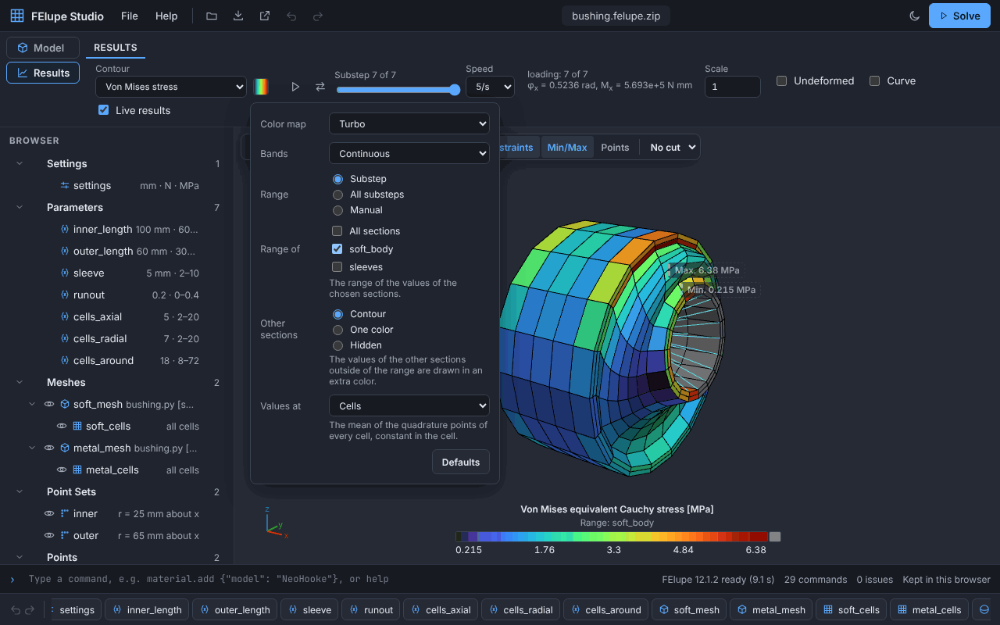

- **Other sections**, below *Range of* when sections are chosen: *Contour* (the default) draws the other sections as above, **One color** without a contour, in a gray of the theme or in a color of your own (a picker or `#rrggbb`; *Default* takes the gray again), and **Hidden** not at all, e.g. the steel sleeves for a picture of the rubber alone. With *Grayscale* the sections in one color are semi-transparent, so they do not look like a value of the map; the hover still shows their values. Hidden sections are not drawn undeformed either, the hover skips them, and the view keeps its place. *Other sections* and its color are kept in the browser with the other contour settings.
- *Substep* and *Scale* of the displacements; *Undeformed* shows the shape before the deformation.
- ▷ (or Space) **plays** the substeps at the chosen *Speed* (substeps per second) in a loop (after the last substep the first one); with ⇄ *Back and forth* pressed, after the last substep backward to the first one, and forward again. The curve and the control points follow. Choose the range over all substeps in the contour settings to compare the colors while playing. Substeps that were shown once are shown at once again.
- *Curve*: the force-displacement curve with the current substep; *CSV* saves it, with the save dialog where there is one. *x* and *y* in the card choose the quantities of the axes: any component of the displacement or of the force of the curve boundary, or the substep, e.g. uy over ux or Fz over the substep. *Axes* sets a log scale, negated values (a compression as positive values) and a fixed range per axis; these options are kept in the browser.
- A hover over the model shows the value at the point under the pointer; *Nodes* shows the nodes of the deformed meshes. *Edges* in the toolbar of the view (on by default) shows the edges of the cells on the deformed shape; without them, the contour of a fine mesh is easier to read, also in an exported picture.
- *Min/Max* marks the minimum and the maximum of the contour with their values: a dot at a node (values at the points) or the outline of the outer faces of a cell (values of the cells). A click on a label or a marker shows where the value is (the node or the cell and its section, *inside* if it is not at the surface); a click elsewhere or Esc hides it again. A label whose point is hidden behind the model is dimmed.
- The control points show their displacements and forces in the substep (rotations and moments for rotation points); the export has them for all substeps. *Points* in the toolbar shows or hides their table.
- **Cut**, the same as in the Model workspace, cuts the results through the **undeformed** model, in every substep, at every scale and the shape of *Undeformed* too: the cut face moves with the material, so it shows the same points of the material in every substep. The contour shows the values inside, and the hover gives them. The range and *Min/Max* stay those of the sections (or of the sections of *Range of*), not of the visible part; a minimum or maximum in the hidden half is not drawn. The constraints and the rigid surfaces are cut where they are in the undeformed model. A cut that was shown once is shown at once again. While a run shows its live results, they keep the cut of its start; a change of the cut applies after the run.

  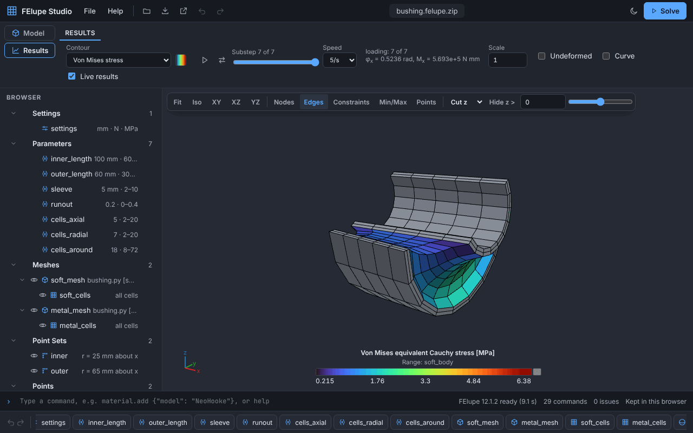

- *Constraints* (or C) shows or hides the lines of the multi-point constraints and the control points, moved with the displacements; they are shown by default. Without them, the contour of a body with many constraints is easier to read, e.g. of a face glued to a rigid plate. The rigid surfaces stay. The toggle is there only in a model with constraints or control points, also during a run with live results.
- A click on a **job** in the browser shows its results; a click on another object switches to the Model workspace with its properties. *Results* shows the results again as you left them; the eye of the browser hides a section in the results too.
- **Import results…** in the File menu, or in the Results ribbon before any run, shows the results of a job of an XDMF file exported before (*Export ▸ Results of the job*), whatever model is open, also without one, e.g. the results of an earlier version of the model or of a colleague. The job is the name of the file, its substeps those of the file; the contour offers what the file has: the values at the cells, and at the points as they were exported, if they were (per section, as after the run). The ribbon says where the results come from, e.g. *Results of bushing-radial.xdmf*. A file has no curve, no control points, no constraints and no steps, and its results are not exported again. They replace the results of the last run, and the next *Solve* replaces them again. A file of version 0.10 names its sections *Section 0*, *Section 1*, … and has no units.

## The script

The ribbon tab **Script** shows the FElupe script of the model instead of the viewport, exactly as it is exported, and updates it after every change. Selecting an object highlights its lines (e.g. a section: its region, field and solid body); a click on a line selects its object, so you can change a value in the properties and see the code change. *Copy* and *Download* take the whole script.

## Exports

The **Export** menu has

- the **Python script** of the model: it runs with FElupe and meshio outside the app, next to the mesh files,
- the **results of the job** (XDMF), which *Import results…* shows again, and of the **substep** (VTU), e.g. for ParaView. With *Values at* the points, the strains and the stresses are at the points too, per section as in the view: every section has its own points in the file, so ParaView shows the sections as pieces that touch, with the jumps of the values at their interfaces,
- the **control points** (CSV): displacements and forces per substep,
- a **picture of the view** (PNG).

Every export asks with the save dialog where the browser has one (see [Save and open](#save-and-open)), with a name of the project and of the export, e.g. `bushing.py` or `bushing-radial-9.vtu`, in the folder of the last export. The file is made after the dialog, e.g. the results of a job in Python; *Cancel* exports nothing. *Export mesh…*, the CSV of a curve and *Download* of the script ask the same way. Without the dialog, each export is a download.

## Python on your computer

The app on GitHub Pages runs Python in the browser (Pyodide). For large models, or for mesh scripts that need packages of your own (e.g. gmsh), the same app runs with the Python of your computer instead, with native NumPy and SciPy on several threads and the memory of the computer (#240).

When to use which:

- **In the browser:** nothing to install, also on a phone or a tablet. A tab has at most about 4 GB of memory (32-bit WebAssembly) and one thread, so a model with a few ten thousand degrees of freedom is the practical limit; single precision (see Building a model) extends it. Mesh scripts use the packages of Pyodide (NumPy, SciPy, FElupe, meshio) and run in the sandbox of the browser.
- **On your computer:** native speed on several threads, the memory of the computer, the linear solver PARDISO, mesh scripts with any package of your Python, and an AI agent on the open model (`--agent`). It needs Python 3.11 or later.

```bash
pip install "felupe-studio[serve]"
felupe-studio serve
```

It prints a link like `http://127.0.0.1:8765/?token=…` and opens it in your browser; `--port` takes another port, `--no-browser` only prints the link. The status bar says *FElupe … ready, local Python …*, and *Help ▸ About* lists the versions of the packages of your Python. Everything else works as in the browser: samples, projects, Solve with live results, *Cancel* (it starts a new Python process), the results and the exports. Ctrl+C in the terminal stops it.

- **Mesh scripts run on your computer with your rights**, not in the sandbox of the browser. So a project with mesh scripts shows them before they run, also without parameters; *Show* reads a script. Only open projects you trust.
- Only this computer reaches the server (`127.0.0.1`), and only with the token of the link; the tab keeps the token, so a reload works. A new start of `felupe-studio serve` has a new token: open its new link. The environment variable `FELUPE_STUDIO_TOKEN` keeps the token (and the link) the same at every start, see [AI agents](agents.md#the-token-in-a-mcpjson).
- Projects are saved and opened through the browser, as in the web app. The session of the tab (the project and its mesh files) belongs to the address, e.g. `127.0.0.1:8765`, so it is not that of the web app on GitHub Pages.
- **PARDISO** (Intel oneMKL): `pip install "felupe-studio[serve,pardiso]"` installs PyPardiso, the *Linear solver* *PARDISO (local Python)* of a job. It factorizes on several threads, so it is faster than SuperLU for large 3D models, e.g. 7 times for a cube with 27,783 degrees of freedom on 2 cores (see [Benchmarks](benchmarks.md#pardiso-of-intel-onemkl-308)). MKL has wheels for x86-64 (Linux and Windows), not for Apple silicon. *Help ▸ About* shows its version. In the browser, or without PyPardiso, a job with PARDISO has an issue, and the model stays the same: another runtime solves it. In single precision, PARDISO needs a PyPardiso that factorizes in `float32`, e.g. adtzlr/PyPardiso; PyPardiso 0.4 solves only in double precision.
- From a clone of the repository: `pip install -e ".[serve]"`, `npm run build` in `app/`, then `felupe-studio serve`.
- **An AI agent on the open model:** `felupe-studio serve --agent` (with `felupe-studio[serve,mcp]`) prints how to add it to an agent, e.g. Claude Code; *Help ▸ Connect an agent* connects the tab. The agent's changes are steps of the history that you can undo, it sees your selection and a picture of the view, and it solves with the live results of the app. A mesh script of the agent runs only after you agree (*Run it*). See [AI agents](agents.md#the-open-app-felupe-studio-serve---agent).

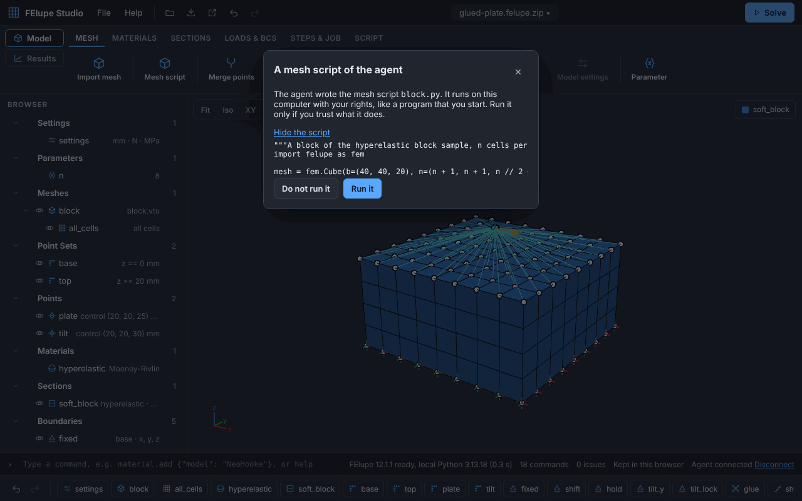

## Keyboard shortcuts

**Help ▸ Keyboard shortcuts** (or `?`) lists them all; the menus and tooltips show them too. The most used:

| Keys | Action |
| --- | --- |
| Ctrl+S, Ctrl+O, Ctrl+Enter | Save, open, solve (⌘ on macOS) |
| Ctrl+Shift+S | Save as a project file or an archive |
| Ctrl+Z, Ctrl+Shift+Z | Undo, redo |
| Delete, F2, Esc | Delete or rename the selected object, clear the selection |
| Ctrl+D, H | Duplicate the selected object, show or hide it |
| Click | Pick a surface; again to exclude it, a third time to deselect it. Deselect a picked node |
| Shift+click | Pick more nodes (with *Nodes* shown), or cycle single faces |
| Long press | Like Shift+click, also on a touch screen |
| Right-click | Deselect a picked or excluded surface, or a picked node, at once |
| F, 1–4, N | Fit, the views Iso, XY, XZ, YZ, show the nodes |
| ←, →, Home, End | The previous, next, first or last substep of the results |
| Space | Play or pause the substeps of the results |

While you type in a field, only Ctrl+S and Ctrl+Enter are shortcuts.

## The command line

Every button creates a command, and so does the command line in the footer. It accepts the JSON of the project file and completes what you type:

```text
material.add {"name": "soft", "model": "NeoHooke", "parameters": {"mu": 1}}
material.add          opens the dialog of a new material
select soft
delete soft
undo · redo · help
```

## Tutorial: a hyperelastic block with a rigid plate

The sample *Hyperelastic block with a rigid plate* glues the top face of a hyperelastic block to a rigid plate. The plate moves 8 mm sideways and tilts by 0.1 rad at the same time. To build it yourself, start a new project and import `block.vtu` of the sample (a block of 40 × 40 × 20 mm):

1. **Mesh:** *Cell set of a mesh* `all_cells` of the mesh `block`, and *Model settings* with the units mm and N.
2. **Materials:** a *Mooney-Rivlin* material `hyperelastic` with C10 = 0.4 and C01 = 0.1.
3. **Sections:** a section `soft_block` of `all_cells` with `hyperelastic`, the formulation `u-p-J` and the bulk modulus 2000.
4. **Point sets:** click the bottom face and create the point set `base` (`z == 0`), click the top face and create `top` (`z == 20`). The viewport suggests names; change them in the properties.
5. **Control points:** select `top`, click *Control point at center*, name the new control point `plate` and move it above the face to (20, 20, 25): this is the center of the plate. Create a second control point `tilt` at (20, 20, 30): its values are the rotations of the plate. Two control points at the same coordinates would be merged, therefore they are apart.
6. **Boundaries:** `fixed` holds x, y and z of `base`. `shift` constrains x of `plate`, `hold` its y and z. `tilt_y` constrains the rotation y of `tilt`, `tilt_lock` its rotations x and z.
7. **Multi-point constraint:** `glue` connects `top` to the center point `plate` in x, y and z, with the rotation point `tilt`.
8. **Step:** `shift_and_tilt` with 8 increments ramps `shift` to 8 and `tilt_y` to 0.1.
9. **Job:** `job` evaluates `shift_and_tilt` with the curve boundary `shift`.

**Solve** and open the results: the top face stays plane, moves with the plate and tilts with it. The curve is the force of the plate in x over its displacement; the control points show the reaction force at `plate` and the moment about y at `tilt`. Compare your model with the sample: the project files have the same commands. Finally, **File ▸ Save project as…** saves it as a *project archive* with its mesh file, e.g. `glued-plate.felupe.zip`, to open it again in one step.

## Tutorial: a bushing made with the mesh tools

The sample *Bushing made with mesh tools* makes its meshes in the app, without a file and without a script. To make them yourself, start a new project with *Model settings* in mm and N. The x axis is the axis of the bushing and y the radius: the section is drawn in the xy-plane and revolved about x.

1. **Lines:** *Primitives ▸ Line* `bottom` from *a* = -50 to *b* = 50 with *n* = 6 points (along the inner sleeve, 100 mm long), and `top` from -30 to 30 with 6 points (along the outer sleeve, 60 mm). Lines are construction meshes, drawn in gray.
2. **Embed:** *Operations ▸ Embed* `bottom_plane` of `bottom` with *value* 30, the line in the plane at y = 30 (the outer radius of the inner sleeve), and `top_plane` of `top` with 60 (the inner radius of the outer sleeve). The browser shows each line below its embedded line.
3. **Fill between:** `section` of `bottom_plane` (*Mesh 1*) and `top_plane` (*Mesh 2*) with *n* = 8: quads between the two lines, the section of the rubber. The two lines need the same number of points.
4. **Add runouts:** `runouts` of `section` with *values* 0.2, *Axis* y, *centerpoint* 0, 45 and *Normalize*: the free ends of the rubber get their concave shape, most at the middle radius 45.
5. **Revolve:** `soft_mesh` of `runouts` with *n* = 19, *φ* = 360 and *Axis* x: hexahedrons, 18 around the axis. This is a mesh of the model; the meshes it is made of are hidden now, and **Show** shows them again.
6. **Sleeves:** *Primitives ▸ Rectangle* `inner_section` from *a* = -50, 25 to *b* = 50, 30 with *n* = 6, 3, revolved like the rubber to `inner_sleeve`, and `outer_section` from -30, 60 to 30, 65, revolved to `outer_sleeve`. Their points at y = 30 and y = 60 are those of the rubber.
7. **Cell sets:** *Cell set of a mesh* `soft_cells` of `soft_mesh`, `inner_cells` of `inner_sleeve` and `outer_cells` of `outer_sleeve`. The meshes are merged at their common points, so the rubber is bonded to the sleeves.

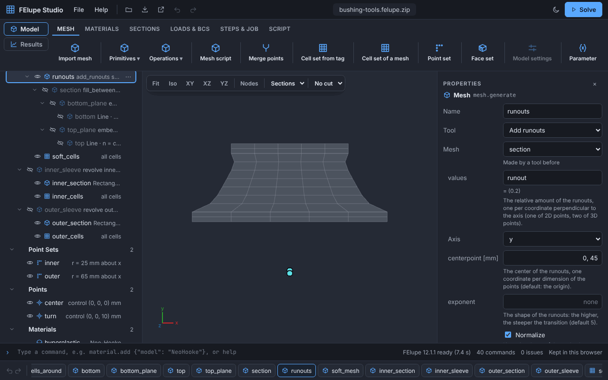

Select a mesh to change its tool or its values: the meshes that use it are made again. The script has one line per mesh, e.g. `section = fem.mesh.fill_between(bottom_plane, top_plane, n=8)` and `soft_mesh = runouts.revolve(n=19, phi=360, axis=0)`. The rest of the model is that of the sample *Bushing with steel sleeves (FElupe ex05)*, built as in the first tutorial: a Neo-Hooke rubber `soft_body` (`u-p-J`) and two steel sections, the point sets `inner` and `outer` on the cylinders of radius 25 and 65 about x, and a multi-point constraint of `inner` to a control point on the axis, which the step moves by 8 mm and turns. Open the sample *Bushing made with mesh tools* and compare: it makes the same meshes with expressions of its parameters, e.g. *value* = `25 + sleeve` or *n* = `cells_around + 1`, so a changed parameter changes all of them.

## Tutorial: a load cycle with the Mullins effect

The Mullins effect shows in a load cycle. This tutorial turns the sample *Material test: uniaxial tension* into one: the cube of a filled rubber is stretched, released, stretched again and on, with the peak of the cycle as a parameter. Open the sample. Its load case `tension` pulls an eighth of a unit cube along x, so a displacement of 0.5 is a stretch of 1.5, and the force is the nominal stress.

1. **Parameters:** a *Parameter* `peak` with the value 0.5, the quantity length, *Minimum* 0.1 and *Maximum* 1: the displacement of the first stretch. A second one, `final`, with the value `2 * peak`: a derived parameter, the displacement at the end. The browser shows it as `1 = 2 * peak`.
2. **Material:** select `hyperelastic`, turn on *Mullins effect* with r = 2, m = 0.05 and β = 0.1, and *Apply*. The browser shows *Neo-Hooke · Mullins*.
3. **Steps:** in the step `stretch`, the *End* of `tension` becomes `peak`. A step `release` ramps `tension` from the *Start* `peak` to the *End* 0, and a step `further` from `peak` to `final`, both with 10 increments.
4. **Job:** the *Steps* of `job` are `stretch`, `release`, `stretch` and `further`: *+ Add step* adds a field, choose the step in it. `stretch` comes twice, without a copy.

**Solve** and open the results. The curve shows the softening: the release needs much less force than the first stretch, and the second stretch follows the release back up to the peak, e.g. 0.16 instead of 0.30 at 0.25, about half, the largest softening of r = 2. At the peak (0.53) it meets the first stretch, and above it the rubber is as stiff as a new one: at the end, the force is 0.875, μ (λ − 1/λ²) of Neo-Hooke for λ = 2. The contour *Max. strain energy density* is the same everywhere in this homogeneous test: 0.146 at the peak, μ/2 (λ² + 2/λ − 3) for λ = 1.5. It stays while the cube is released and grows only beyond the peak, to 0.5 at the end. Change `peak` with *All parameters…* in the menu of a parameter in the browser, e.g. to 0.3: the steps, `final` (0.6) and the curve follow.

## Limits of version 0.10

FElupe Studio has no meshing from CAD: meshes come from files, Python scripts or the mesh tools of FElupe. The mesh tools of the app are the primitives point, line, rectangle, cube, circle and triangle and nine operations, for structured meshes of lines, quads and hexahedrons; other tools of FElupe, e.g. tetrahedrons (`triangulate`) or quadratic cells (`convert`), need a mesh script. A stacked mesh has one cell set of all its cells: its pieces have no cell sets of their own, and a mesh made of a mesh of a file has no cell sets of its tags. FElupe Studio has no contact between two deformable bodies or of a body with itself; contacts are of points with rigid planes and cylinders.

There is no server on the internet. Python runs in the browser, or on your computer with `felupe-studio serve`. An AI agent works headless with the MCP server, or with `felupe-studio serve --agent` on the model that is open in a tab on your computer. A deployment under its own name is a build of the app with a brand folder, not the released app or wheel branded later; the Python package, its command line and the MCP server keep the names and the texts of FElupe Studio.

A step switches a boundary off at once: its reaction force is not ramped to zero. Boundaries and loads keep their points and directions from step to step, and the time of a step plays no role. A job may repeat a step, e.g. for a load cycle. A parameter is a number or an expression of other parameters (a derived parameter); the numbers of the objects may be expressions of the parameters, but not of other objects. 2D models are plane strain or axisymmetric, not plane stress.

The plasticity is von Mises plasticity with linear isotropic hardening, the Mullins effect of Ogden and Roxburgh is the only inelastic model of rubber (no viscoelasticity yet, which needs the time of a step), and a user-defined material is a Python file (a constitutive model, a strain energy function or a strain-based function), without an inline editor and without contours of its state variables. The accuracy of a model in single precision depends on the model: the job panel estimates it, and a strain-based model of the registry keeps the linear system in double precision.

Results are imported from the XDMF files of the export only, not from VTU files, and not by the MCP server or the agent bridge.

The cut is one plane normal to x, y or z, through the undeformed model: there are no cuts by other planes and no several cuts at once. It is a setting of the view, in the picture of the view, but not in the exports of the results (XDMF and VTU), which have the whole model, nor in the results of the MCP server and of the agent bridge.

The save dialog of the system is that of Chrome and Edge on the desktop, unless their site setting *File editing* or a policy blocks it; Firefox, Safari and the browsers of phones download the files. The app keeps the file chosen in the save dialog in memory only, so after a reload the next save asks again, and it does not save into the file that a project was opened from.

There are two themes, dark and light. The picture of the view has the background of the theme, so a picture on white needs the light theme. *Range of* chooses the sections of the range in the app; the results of the MCP server and of the agent bridge have the ranges of all sections and of each section, not that choice.

On a phone, the app is the same as on a computer, in a compact layout, not an own view for phones. It is made for opening a sample or a project, setting its parameters, solving and looking at the results; a model is easier to build in a larger window. A large model solves more slowly in the browser of a phone than on a computer.

A project that uses what is new in version 0.10, the boundaries of a step (*Boundaries* and *Switched on*) or the mesh tools *Circle*, *Triangle* and *Stack*, does not open in versions 0.9 and 0.8, which name it (*This project uses the property `boundaries` of `step.add`, which FElupe Studio 0.9.0 does not know*), nor in version 0.7 and earlier, which list the errors of the schema. The same holds for a project that uses what is new in version 0.9 (the color of a section or of a cell set) in version 0.8, and for what is new in version 0.8 (a repeated step, a derived parameter, the color of a mesh or the Mullins effect) in version 0.7 and earlier.

See the [roadmap](https://github.com/adtzlr/felupe-studio/issues/399).
